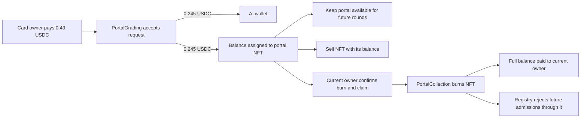

# Portal fee accumulation and burn to claim implementation plan

Updated 8 November 2026. This is the implementation specification for the change to the [portal product plan](portals-implementation-plan.md). The change is implemented and validated locally; public-network rehearsal and deployment remain release work. See the [implementation handoff](portals-burn-to-claim-handoff.md) for the completed changes and current checks.

Each successful portal admission credits the portal fee to the particular portal NFT used. The current owner receives its entire accumulated USDC only by burning that NFT. Transfers carry the balance with the portal. The AI fee continues to go to its configured wallet, and accepted grading jobs continue after portal retirement.

## Product behavior and implementation defaults

The agreed economic rules are:

- Rainbow admission costs 0.49 USDC: 0.245 to the AI wallet and 0.245 held for the portal NFT. Admin can update future fees per kind.
- The claim belongs to whoever owns the portal at redemption, including a buyer who did not own it when it earned its fees.
- A claim burns the portal and pays its full balance atomically. No partial withdrawal or withdrawal while keeping the NFT.
- Burning permanently reduces live supply and does not restore a kind's lifetime mint allowance. Admin can still mint unused allocations or new kinds.
- The monster card being graded is separate from the portal NFT being burned. Burning either does not cancel accepted grading jobs.

The following defaults resolve the timing and user-interface edge cases and are implemented with this change.

| Case                                                  | Planned behavior                                                                                                                                                               |
| ----------------------------------------------------- | ------------------------------------------------------------------------------------------------------------------------------------------------------------------------------ |
| Claim outside the portal's active slot                | Allowed. The 11-minute restriction governs submitting cards, not redeeming portal ownership.                                                                                   |
| Claim during the portal's active slot                 | Allowed immediately; new admissions stop. The scheduled end remains unchanged, so another portal cannot open early.                                                            |
| Claim while AI jobs are pending                       | Allowed. Those jobs retain their original terms and complete normally.                                                                                                         |
| Zero accumulated USDC                                 | Owner may deliberately burn for zero, with an explicit zero-payout confirmation. No ERC20 transfer is attempted.                                                               |
| Pending VRF draw chooses a portal subsequently burned | Preserve the chosen ID and consume a closed 660-second round. No substitute NFT, new seed or immediate reroll for that round.                                                  |
| Only one live portal remains                          | It can repeat in successive rounds; each round still requires the normal permissionless VRF request and activation.                                                            |
| No live portals remain                                | Admission stays closed and new rotation/selection requests reject before charging VRF fees. An outstanding request can still be settled. New minting can restore availability. |
| Sale races with redemption                            | Transaction ordering decides: if the transfer executes first, the old owner's claim fails; if redemption executes first, the NFT no longer exists and its sale fails.          |

A retired VRF result creates a deliberate empty slot. This permits immediate owner redemption without letting burns remap the random result to a preferred surviving NFT. An owner can still sacrifice their own portal to forfeit its selected slot; the design does not claim to eliminate that behavior. There is at most one accepting portal, and there can be none during retirement, expiry or oracle delay.

## Architecture and current integration points

Keep custody and balances in the existing upgradeable `PortalGrading` contract. It already collects USDC and serializes admissions with a reentrancy guard. This keeps one player approval target, avoids an additional treasury proxy and makes admission, fee credit and redemption consistent within one accounting contract. `PortalCollection` remains authoritative for ownership and retirement; `PortalRegistry` remains authoritative for activation.



The diagram describes the initial Rainbow fees. Burn, accounting updates and payout are one transaction; any failure reverts all of them.

| Area                           | Current code                                                                                 | Change                                                                                            |
| ------------------------------ | -------------------------------------------------------------------------------------------- | ------------------------------------------------------------------------------------------------- |
| Fees and grading               | `contracts/boosters/src/PortalGrading.sol`                                                   | Replace direct portal transfer with escrow; add balance reads and redemption.                     |
| Portal ownership and pools     | `contracts/boosters/src/PortalCollection.sol`                                                | Controlled burn, live indexes, historical pool snapshots and retired-token reads.                 |
| Rotation and utility draws     | `contracts/boosters/src/PortalRegistry.sol`                                                  | Use live snapshots, check retirement, settle unavailable outcomes and handle shrinking supply.    |
| VRF and gate helper            | `PortalRandomness.sol`, `PortalRules.sol`                                                    | Preserve authenticated seed delivery/recovery; adjust metadata description if needed.             |
| Shared interfaces              | `packages/yunipals-market-core/src/portalAbi.ts`, `portals.ts`                               | Regenerate ABI and add typed balance, supply, claim and rotation state contracts.                 |
| Chain reads and API            | `apps/yunipals-indexer/lib/portals/chain.ts`, `routes.ts`, `runtime.ts`                      | Read retired portals safely; expose holdings, balances, activity and supply.                      |
| Discovery and accounting index | New `lib/portals/ledger.ts`, `ledger-store.ts` and `scripts/portal-ledger.ts` in the indexer | Index transfers, credits and redemptions independently of AI processing.                          |
| Player UI                      | `apps/yunipals-home-web/src/pages/portals`, `src/hooks/usePortals.ts`, `src/lib/portals.ts`  | Add owner holdings/detail pages and claim transaction flow; update admission copy.                |
| Admin and setup                | `PortalAdminPage.tsx`, `prepare.ts`, `prepare-portals.ts`, environment examples              | Remove fixed portal recipient configuration, bind claim authority and validate economics version. |
| Release checks                 | `contracts/boosters/test`, `scripts/portals`, local integration/browser scripts              | Cover reserves, ownership, snapshots, retirement, claims, upgrades and browser recovery.          |

## Contract accounting and claim authority

### Payment storage and policy compatibility

Append `mapping(uint256 => uint256) portalBalances` and `uint256 totalPortalLiability` in `PortalGrading`, consuming its reserved storage gap. Expose `claimable(portalId)` and `portalEconomicsVersion()` returning the new interface version. Amounts are integer USDC base units with six decimals.

Keep the existing stored `PaymentPolicy` and accepted `Request` structures in their existing order. The old `portalRecipient` field is retained for storage/request-binding compatibility; new policies must set it to the grading proxy itself as the escrow destination. Add the four-argument `setPaymentPolicy(kindId, aiFee, portalFee, aiRecipient)` used by new tooling. Retain the old five-argument selector only as a deprecated compatibility entry that rejects any portal recipient other than the grading proxy and calls the same internal setter. Neither selector may restore direct payouts.

Expose `portalFeeMode: "accumulate_and_burn"` and `portalEscrow` in the application schema so clients do not present the retained storage field as a configurable owner wallet. Preserve existing accepted-request encoding and hashes. Reject zero AI recipients and the grading proxy as its own AI recipient, which would otherwise mix unallocated AI fees with escrow reserves.

### Admission and backed credits

Keep all current checks for active portal/round, gates, card ownership, pending job, artwork, rubric, nonce and price version. Also require the portal to exist and the collection's claim authority to be bound to this grading proxy.

Within the same guarded transaction:

1. Create the accepted request using the existing snapshot fields and immutable request ID.
2. Transfer the AI component from the submitter to the configured AI wallet.
3. Transfer the portal component from the submitter to the grading proxy; verify the proxy's USDC balance increased by exactly that component before treating it as funded.
4. Increase that portal's balance and `totalPortalLiability` once, then emit the credit and accepted-request events.

Any failure rolls back both payments, nonce/request state and the portal credit. A zero fee remains valid and creates no unfunded credit. No external generic credit method is introduced. AI completion, retries and regrading of a different accepted request cannot credit an old request again.

Use `PortalFeeAccrued(requestId, portalId, amount, newBalance)` to associate each credit with one admission. Emit the existing allocation event with the escrow contract in its retained destination field, and update every consumer to use the new credit event as its accounting source. Emitting both must not double-count revenue.

### Atomic owner redemption

Add `burnAndClaim(uint256 portalId, uint256 minimumAmount, uint64 deadline)` on `PortalGrading`, protected by the same reentrancy guard as admission. A claim is independent of admission and randomness pause flags, the active slot, pending draws and pending grading jobs.

Execution order:

1. Require an unexpired deadline and a live portal whose `ownerOf` equals `msg.sender`. ERC721 approval alone does not authorize redemption.
2. Read its current balance and require it to be at least `minimumAmount`. Additional fees earned after the user's review are included in full.
3. Zero the balance and decrease the total liability.
4. Call the collection's restricted `burnForClaim(portalId, expectedOwner)`, which checks the owner again and retires the token.
5. Transfer the full amount to `msg.sender` with `SafeERC20`; skip the transfer for zero. Emit `PortalClaimed(portalId, owner, amount)` only on success.

There is no arbitrary recipient parameter, admin claim, or ordinary withdrawal of escrow USDC. A failed USDC transfer, including a token pause or recipient restriction, reverts the burn and all accounting. Unsolicited USDC transfers do not increase any NFT's entitlement; reserves can exceed liabilities. Do not add a rescue path for escrow USDC as part of this change.

The transaction's minimum amount and deadline protect the reviewed claim. Use a short frontend deadline, such as ten minutes from the current block timestamp. Expiry merely requires a fresh review; it does not expire the NFT's balance.

### Collection binding and retirement

Append a one-time `claimController` binding to `PortalCollection`. Only its configuration authority can bind the approved grading proxy, after validating that proxy's registry points back to this collection. Setup must complete this binding before enabling paid admissions. The existing UUPS authority remains responsible for future contract upgrades; ordinary configuration cannot switch the controller or empty balances.

Only that controller may call `burnForClaim`. There is no public `ERC721Burnable` path and no marketplace-approved burn path that could bypass payment accounting. Check `expectedOwner`, remove the token from live pools, burn it through ERC721, and emit `PortalRetired(portalId, kindId, owner, poolRevision)`. A contract wallet can redeem by executing the call as the NFT's owner; its operator cannot redeem independently.

Retain the kind, gates, historical mint indexes and allocation counts. Add `exists(portalId)` and a historical `portalRecord(portalId)` getter that can return known retired portals without calling `_requireOwned`. Unknown/unminted IDs remain distinguishable. Keep the standard `ownerOf` and `tokenURI` behavior for burned ERC721 tokens; API history uses the historical getter instead.

## Stable selection as live supply changes

### Versioned live pools

The existing registry snapshots an array length and later reads `portalAt(index)`. Removing entries with a normal swap-and-pop would change pending results, while leaving all retired entries in future draws would waste more rounds over time. Add versioned dense live pools alongside the existing historical arrays.

For the global pool and each kind, maintain a dense live token array and token-to-live-index mapping. Record the value at each changed array position in a checkpoint history; also checkpoint each pool's live count. A monotonically increasing collection-controlled `poolRevision` identifies a completed eligibility mutation. Transfers do not change eligibility or revision.

- On mint finalization, append each revealed token to the global and kind live pools and record its positions/counts.
- On burn, move the last live token into the removed position, checkpoint the changed position and cleared tail, update the moved token's index, and decrease/checkpoint the count.
- Increment revision for each atomic mint-finalization batch or burn. All changes in a batch share that revision; distinct transactions in the same block receive distinct revisions.
- Snapshot `{revision, count}` at VRF request time. Resolve a random index using its historical value at that revision, never the current dense array.

Use packed checkpoints with a `uint48` revision and checked `uint208` token/count values. The implementation uses the focused `PortalPool` library with binary historical lookup rather than inlining the full OpenZeppelin checkpoint library, which exceeded the collection's EIP-170 code budget in the prototype. Kind validation is delegated to the existing stateless `PortalRules` helper. Enforce the representable token-ID bound when configuring kinds and checked revision increments; never truncate user values. History lookup is logarithmic in changes to a position and does not scan the collection. Keys are controlled by the collection and increase per atomic eligibility mutation. Fuzz and full-kind tests cover historical lookup, index reuse and burns.

Add `livePortalCount(kindId)`, `liveIndexPlusOne(portalId)`, `poolSnapshot(kindId)` and `portalAtSnapshot(kindId, revision, index)`. Validate historical count/index bounds. Keep existing `portalCount`/`portalAt` and global historical indexes as historical enumeration, with documented naming, so old storage is not repurposed silently.

Unit and invariant tests must cover index reuse, middle/tail burns, same-block request/mutation order, multiple kinds, mint batches and repeated swaps. Measure storage growth and gas at a full 1,000-token kind plus multiple kinds. No redemption or settlement may require a loop over all portals, owners, jobs or requests.

### Rotation settlement

Store each rotation's pool revision in a new mapping to preserve the existing stored struct layout. Snapshot the live count and the previous portal's live index. Exclude the previous portal when at least two live portals exist; waive that exclusion when it is the only live portal. New requests with no eligible tokens revert before making the paid wrapper call.

`activateNext()` still requires the original request's seed and cannot run before the preceding round's recorded end. Resolve exactly one historical candidate from the committed snapshot:

- If live, record the normal 660-second round and emit activation.
- If retired, record its ID and a 660-second closed round starting at settlement, clear the pending request, and emit `PortalRoundUnavailable`. Do not emit a successful activation or try another candidate. The next distinct round can be prepared during this closed interval.

An active portal burned midway through a round becomes non-accepting immediately. Its stored `endsAt` is retained. If the next result is ready, it still waits for that timestamp; if late, the next settled round starts at settlement as before. Preserve the fact that historical rounds did open even if their token is now retired.

`activePortal()` must require both a valid time window and a live portal. Add an explicit status getter distinguishing `not_started`, `open`, `expired`, and `retired`, together with supply and request readiness, so callers can explain why entry is closed. Record retired selection outcomes separately from later expiry.

Keep VRF callbacks limited to storing their authenticated seed. Burn or mint mutations cannot alter the committed candidate mapping, and no cancellation, substitute entropy or retry with a new seed is introduced. These requirements apply Chainlink's guidance on fixed request inputs, request identity and avoiding rerolls; the empty-slot rule is this application's design choice. [Chainlink VRF security considerations](https://docs.chain.link/vrf/v2-5/security)

### Utility selection

Global and per-kind utility requests use the same versioned live snapshots. Add `selectionStatus(requestId)` returning fulfillment readiness, the originally selected token ID, snapshot revision and current availability. Keep any legacy result getter explicitly documented as a historical selection result, not proof the token still exists. A result's ID never changes after fulfillment; availability may become false if its owner redeems it. Utility requests never block redemption or affect activation, and abandoned utility requests cannot lock owners' funds.

## Shared interfaces and upgrade checks

Regenerate `portalAbi.ts` from release artifacts with `scripts/portals/export-abi.py`. Define shared typed status values and decimal-string API quantities in `packages/yunipals-market-core/src/portals.ts`, including `portalFeeMode`, supply, balances, retirement and selection availability. Keep all uint256 values as bigint onchain and strings in JSON; convert to formatted six-decimal USDC only for display.

Preserve existing request/payment/rotation storage layouts, inherited storage order and grading request hashes. Add state through reserved gaps with exact slot accounting. Keep existing baselines and review new fields; do not overwrite baselines to make an incompatible change appear valid. This follows the upgrade rules for preserving variable layout and correctly consuming storage gaps. [OpenZeppelin upgradeable storage guidance](https://docs.openzeppelin.com/upgrades-plugins/writing-upgradeable#modifying-your-contracts)

This release targets the new, not-yet-deployed portal stack. There is no historical portal balance to migrate and no migration manifest is needed. Storage compatibility alone is not evidence that an older populated portal deployment has initialized live indexes correctly; an unexpected existing deployment must stop the fresh-deployment procedure and receive a separate state-aware upgrade plan.

Add upgrade tests from a populated revised implementation to a compatible next implementation, preserving reserves, owners, burned state, pool checkpoints, pending requests and grades. Run EIP-170 size checks after each contract change using `FOUNDRY_PROFILE=permit`. Both collection and grading contracts are already substantial; implement the ledger/snapshot prototype and measure deployed sizes early. Do not change the existing monster mint engine for this feature; its current size budget is especially tight.

## Indexing and API

### Public ownership and accounting index

The current worker indexes grading requests, not portal ERC721 ownership. Add a separate read-only ledger process so portal discovery and accounting do not depend on an OpenAI key, grader key or successful AI jobs. Reuse the RPC/deployment validation and PostgreSQL connection conventions, but give this process its own cursor and startup command. It must run continuously after launch, not only during tests.

Add deployment-scoped tables for canonical public events, portal ownership/accounting projections, and the ledger cursor. The deployment identity includes chain and collection/grading addresses. Store amounts/token IDs as exact numeric values, normalized addresses, and event block number/hash, transaction hash/index and log index. Index owner plus token ID for holdings and claimant plus event order for redemption history.

Consume collection `Transfer`, `PortalMinted` and `PortalRetired`, grading `PortalFeeAccrued` and `PortalClaimed`, and relevant registry round events. Order across all contracts by block, transaction and log position. A burn transfer removes ownership; only the claim event reduces the indexed balance, avoiding double application when both appear in one transaction. Support zero-value credits/claims and immediate transfer/burn after mint in the same block.

Use bounded log batches and a configured confirmation horizon. Persist canonical events, projections and cursor in one database transaction on one connection. Enforce event uniqueness and request-credit uniqueness. On a cursor block-hash mismatch, invalidate affected projections and replay canonical events from the deployment start; never retain a claim from an orphaned fork. This replay is independent of the private spell/job tables and must not discard grading progress.

Track collection/registry/grading deployment start blocks separately or use a verified earliest stack block. The existing grading start block alone must not omit earlier portal mint events. Do not conflate new portal NFTs with OG Rainbow/Ghost NFTs used for airdrop eligibility.

### Read routes

| Route                                       | Response and behavior                                                                                                                                                                 |
| ------------------------------------------- | ------------------------------------------------------------------------------------------------------------------------------------------------------------------------------------- |
| `GET /v1/portals`                           | Existing active state plus economics version, reason entry is closed, live/historical/burned supply and escrow/liability summary. Handle a retired recorded portal without reverting. |
| `GET /v1/portals/owners/:address`           | Paginated live portal holdings with artwork, kind, gates, current owner, accumulated USDC and active/retired status. Default page size 24, maximum 100.                               |
| `GET /v1/portals/tokens/:portalId`          | Live or retired portal detail, claimable balance, lifetime earned/claimed totals, last owner/redemption evidence and read block. Unknown token returns 404.                           |
| `GET /v1/portals/tokens/:portalId/activity` | Paginated public credits, transfers and redemption, with transaction links and request IDs. Never expose pending private spell text.                                                  |
| `GET /v1/portals/owners/:address/claims`    | Paginated confirmed redemption history showing actual claimant and amount.                                                                                                            |

The existing `/cards/:tokenId` routes remain monster grading history. Keep portal and monster IDs explicitly separated in types, paths and transaction construction.

Use indexed ownership for discovery and direct contract reads for monetary/claim state. Read `exists`, owner, balance, kind and status at one pinned RPC block for each detail/review response. Expose `asOfBlock`, block hash and `indexedThroughBlock`; label delayed discovery instead of representing an incomplete index as an empty wallet. Use deterministic keyset pagination with an index snapshot identifier; restart pagination when its snapshot is invalidated by a reorg.

Fix `PortalChain.active()` before enabling burns: it currently calls `gates()` for the round's token, and that getter requires a live owner. Read retirement first and use historical portal data when retired. Make admission quote reads consistent at one block and return a helpful closed/retired error rather than a generic API failure.

There is no server-side claim transaction or signing endpoint. The frontend simulates and submits directly to the pinned grading contract. Read-only balance/owner lookup by portal ID also lets an owner reach a newly received portal before holdings indexing catches up.

### AI worker and metadata

Continue processing the accepted grading request using its snapshotted portal ID, kind, fees, artwork and rubric. Do not require the portal to still exist, have an owner or retain an unpaid balance. Any worker/report code that needs portal details uses historical records. Completion does not release funds or adjust escrow.

Keep the finished shared portal card art and fixed gate traits. Add a concise economic description to portal metadata if appropriate, but use authoritative live reads for claimable USDC rather than a cached marketplace metadata number. Preserve retired portal artwork, gates and activity in the app's detail/history response even though ERC721 `tokenURI` reverts after burn. Update the system illustration's payment arrow and owner redemption flow during implementation using the existing actual Yunipals assets.

## Frontend owner experience

### Pages and navigation

Add `PortalOwnerPage.tsx` at `/portals/mine`, `PortalTokenPage.tsx` at `/portals/tokens/:portalId`, and a reusable `PortalClaimDialog.tsx` under the portal page folder. Register named lazy imports/routes in `App.tsx`. Add a visible **My portals** link from the main portal page and links back to the active portal and claim history. Use existing React Query, wagmi/viem, router links, button/dialog primitives and Yunipals styling.

Each owned portal card shows its finished TCG image, name/ID, key gates, accumulated USDC, active status and **Burn portal & claim** button. Show a wallet total across holdings only when the data is complete or explicitly mark it as a page subtotal. A details page offers the same claim action and readable payment/transfer history. Retired tokens show the redemption result instead of an enabled claim button.

The existing collector/marketplace registry does not yet enumerate this new portal collection. Add a clear link from the collector view to **My portals** for the connected owner rather than assuming the OG token feed will discover them. Full new marketplace trading support is a separate feature; ordinary ERC721 transfers already carry the balance. Never match tokens solely by numeric ID across collections.

### Claim review and transaction

Add a focused `usePortalClaim` hook and reusable contract-binding checks shared with `usePortals`, rather than sending arbitrary calldata from an API response. The claim process is:

1. Connect the wallet and select the configured chain. Load the portal record.
2. Derive registry/collection/USDC from the pinned grading contract; compare API configuration and verify the collection's `claimController` and economics version. Read owner, existence and full balance directly at one block.
3. Open a confirmation dialog identifying the exact portal, payout, connected recipient and current status. Show: **Burning permanently destroys this portal. You will receive its full accumulated USDC and it will no longer earn fees.** Require an explicit acknowledgment. A zero balance states **You will receive 0 USDC** prominently; an active portal also explains that entry closes immediately.
4. Re-read ownership/balance before signing. If ownership or availability changed, close the outdated review and explain why. If the balance increased, update the displayed amount; set `minimumAmount` to the reviewed amount and a ten-minute deadline from the latest block timestamp.
5. Simulate `burnAndClaim` from the connected owner, then ask the wallet to submit with zero native value. There is no USDC approval, NFT approval, permit, spell signature, AI charge or VRF fee for redemption; the wallet pays ordinary network gas.
6. Show wallet confirmation, pending transaction and confirmed result states. Parse `PortalClaimed` only from the pinned grading address and expected portal/owner. Display the actual event amount, which may be higher than the reviewed minimum.
7. Invalidate holdings, portal detail/activity, root active/supply state, claim history, collector ownership and wallet USDC balance queries. Immediately show the successful claim using receipt evidence while confirmed indexing catches up.

Use integer/decimal helpers, not floating-point currency arithmetic. Prevent duplicate clicks and reset review data on account, chain or deployment changes. Handle rejected signatures, reverted transactions, deadline expiry, changed ownership, insufficient ETH, unavailable USDC transfers and stale RPC/API state with local recoverable messages.

Handle transaction replacement/cancellation explicitly. Retain pending transaction identity across navigation/reload, reconcile its receipt and do not display success merely because a hash exists. A chain reorg can revert a previously seen burn; refetch authoritative state and downgrade the UI appropriately. Claim success must never depend on an AI worker or indexer being online.

### Existing player and admin screens

Update the admission fee breakdown to say the portal fee accumulates on the displayed NFT. A retired active portal shows **This portal was redeemed** and disables spell entry while preserving the scheduled countdown. A closed slot selected from a retired result shows when the next slot can begin. Zero supply shows **No portals available** and disables paid rotation requests. A sole remaining portal explains that it may repeat.

In `PortalAdminPage.tsx`, remove the portal-recipient wallet input and use the new four-argument fee setter. Keep AI recipient, AI fee and portal fee editable; display the portal destination as **Accumulates on each portal NFT**. Add read-only live/minted/burned counts and reserve/liability status. Admin UI must not imply it can claim another owner's balance.

All new pages require loading, retry, disconnected-wallet, wrong-chain, no-holdings, index-catching-up and retired-token states. Verify mobile layout, keyboard navigation, focus restoration, dialog labeling and screen-reader transaction updates. The destructive action must be clearly named; avoid an ambiguous **Claim rewards** button.

## Configuration and release procedure

Remove `PORTALS_FEE_RECIPIENT` from the public environment example and setup input type/parser. Keep `PORTALS_AI_RECIPIENT` and all existing approved admin/grader configuration. Old operator configuration may still contain the obsolete variable; the updated setup tool must not use it or ask the user to provide another payout address.

Update `DeployPortals.s.sol`, `preparePortalSetup`, `prepare-portals.ts` and the local integration fixture to bind collection claim authority, verify the escrow destination, and configure the new policy. Since the final admin may differ from the deployer, emit reviewable unsigned binding/setup calls for that admin rather than assuming the deployer can exercise its role. Keep admissions disabled until binding, model/artwork configuration and all checks succeed.

Add the ledger command and its deployment start/confirmation settings to the runbook and package scripts. Its runtime needs RPC and database access only. Keep API/worker secrets on their existing authorized server configuration and real addresses/receipts in private operator records.

The frontend and API require the new economics version before enabling admission or redemption. Publish compatible ABI, API and UI together behind the existing feature flags. Review calldata must show the grading proxy as escrow, and no fixed portal-owner payout wallet.

Rehearse on Base Sepolia with the real direct-funding wrapper and a six-decimal test USDC deployment before production. Refresh the OG-holder snapshot when preparing the separately chosen airdrop allocation; burn-to-claim does not decide the recipient quantity policy. Before the first airdrop/admission, verify supply/accounting are initialized, live indexes agree with minted tokens and both deposits and owner exits work.

Rollback of a frontend/API release must not restore a UI that describes direct payouts. Once balances exist, do not downgrade to contract code without escrow accounting or remove the owner's exit path. Pausing new admissions must leave redemption and accepted grading completion available. Monitor escrow USDC versus total liabilities, ledger lag/reorgs, failed claims, retired rounds and live supply. Direct USDC donations create surplus, so alert on deficits rather than requiring reserves to equal liabilities exactly.

## Tests and acceptance criteria

| Layer                 | Required cases                                                                                                                                                                                                                                                                                                |
| --------------------- | ------------------------------------------------------------------------------------------------------------------------------------------------------------------------------------------------------------------------------------------------------------------------------------------------------------- |
| Admission accounting  | Exactly 245,000 units to AI and 245,000 to the used NFT; multiple uses/kinds; zero fees; fee updates affect future entries only; failed/stale/closed admissions move no USDC; exact received amount; no duplicate credit on AI completion.                                                                    |
| Claims and ownership  | Owner receives full balance; transfer carries accrued balance; old owner/operator/admin rejected; controller binding enforced; zero payout allowed deliberately; minimum/deadline guards; duplicate claim rejected; failed token transfer rolls everything back.                                              |
| Security and reserves | Reentrant/token-failure mocks; multiple owners and liabilities; unsolicited donations; claims during admission/randomness pauses; invariants after randomized admissions, transfers, fee updates, burns and completions.                                                                                      |
| Pools and VRF         | Uniform rank mapping within the captured live pool; swaps/index reuse; same-block mutations; old seed recovery; unrelated/selected/active burns; immutable utility result; no early activation or reroll; one/zero live tokens; pending mint completion; bounded gas.                                         |
| History and upgrades  | Accepted job completes after portal claim and card transfer/burn; original request binding preserved; retired portal history accessible; no token ID/cap reuse; upgrade preserves balances, checkpoints and pending work; storage/size checks.                                                                |
| Ledger and API        | Mint-transfer-credit-claim replay; correct owner/claimant; idempotent logs; same-transaction event ordering; reorg invalidation/replay; atomic cursor; pagination; catching-up state; unknown versus retired token; root status does not call live-only gates on a retired token.                             |
| Frontend              | Correct collection/contract pin; disconnected/wrong network; full balance shown; explicit irreversible confirmation; no approval request; zero balance; wallet switch; rejection/revert/replacement; pending reload; actual receipt amount; stale ownership; mobile/accessibility; historical claim evidence. |
| End to end            | Real local contracts and browser: pay, accumulate, transfer portal, claim as buyer, verify USDC/burn/supply, reject future admissions, finish the already paid AI job, then rotate correctly with survivors. Repeat the public-wrapper flow on Sepolia.                                                       |

Core invariants after every successful transaction:

```text
USDC held by grading >= totalPortalLiability
totalPortalLiability == sum of all live portal balances
live portals + burned portals == fully minted portals
per kind: fully minted including retired + pending reserved IDs == allocated <= cap
burned portal => claimable balance 0 and cannot accept a new card
accepted grading request => portal credit applied exactly once
one request + its snapshot + its VRF seed => one fixed selected token ID
at most one portal accepting, always within its recorded 660-second interval
```

The liability sum is a test/reconciliation invariant, not an onchain loop. Retain the existing portal/booster regression coverage, TypeScript checks and production frontend build. Run focused new tests first, then the complete affected suite once the change stabilizes. Existing green checks are not acceptance evidence for the new feature.

## Implementation order and completion criteria

| Step | Deliverable                                                                  | Completion check                                                                                                                                                       |
| ---- | ---------------------------------------------------------------------------- | ---------------------------------------------------------------------------------------------------------------------------------------------------------------------- |
| 1    | Accounting/claim interfaces, controller binding and versioned-pool prototype | Solidity unit tests, storage-prefix checks and release-size/gas feasibility pass before frontend work.                                                                 |
| 2    | Live snapshot rotation, unavailable rounds and utility status                | Stateful tests cover burning before/after fulfillment, active slots and one/zero supply without rerolls.                                                               |
| 3    | Generated ABI, shared types, setup calls and fixtures                        | Type checks pass; unsigned setup contains escrow and binding calls; obsolete recipient input cannot redirect fees.                                                     |
| 4    | Public ledger process and API routes                                         | Canonical replay, reorg, ownership, pagination and retirement reads pass; process operates without AI credentials.                                                     |
| 5    | My portals, detail/history and burn-and-claim UI                             | Browser proves owner confirmation, a single claim transaction, payout, disappearance from holdings and retained receipt/history.                                       |
| 6    | Admin/admission copy, metadata description, illustration and docs            | All public flows describe accumulation and burning consistently; no direct portal-wallet instructions remain.                                                          |
| 7    | Full local regression and real-wrapper Sepolia rehearsal                     | Validate payment, sale/transfer, claim, pending grading completion, pool retirement and reserve reconciliation together.                                               |
| 8    | Production transaction review and release                                    | Deploy verified fresh portal contracts, complete admin binding/setup, start ledger/API/workers, enable compatible UI and execute the chosen airdrop only after review. |

The feature is complete only when an owner can discover their portal, verify its balance, burn it through the frontend, receive exactly the onchain entitlement, and see the portal permanently leave live eligibility while previously accepted grading work still completes.
