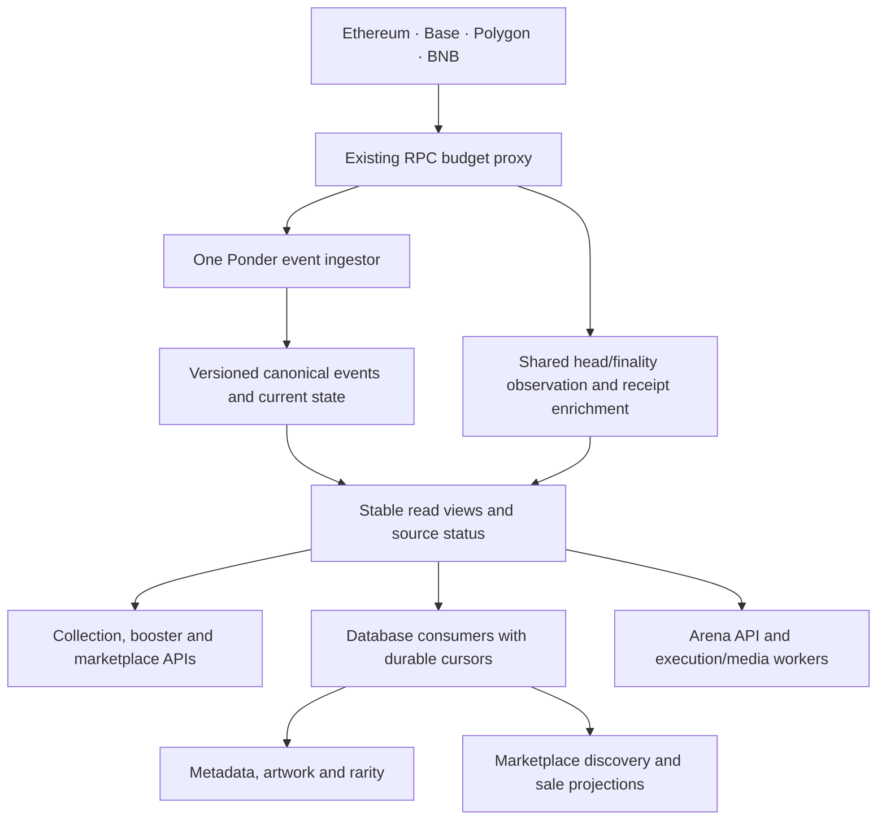

# Unified Yunipals indexer implementation plan

Prepared 20 October 2026. Updated 25 October: the combined YPAL source has caught up and runs under the approved ongoing Alchemy caps. Corrected V5 views and their71 equivalent reads are applied; a fresh canonical capture qualified all six collection sources. The transient provider-lag observer correction is live and separately revalidated; later Base probes report ready. Replacement main API and Arena artifacts are installed inactive. Metadata's initial drain needs bounded coverage rechecks, and cache/reader transaction timing is being qualified before handover. Metadata, derived generation/cache, consumer cutover, fresh YPAL feature handover, managed Solana adoption and duplicate-scanner retirement remain pending. See the [current checklist](unified-indexer/CHECKLIST.md) for actual rollout evidence and remaining work.

Revised after the Arena discussion and live inventory: use native Ponder handlers and tables for EVM chain state. Solana consolidation is included at the user's request. Following the discussion about extra Base blocks, the working implementation policy is latest complete Base blocks, with canonical/current-state checks and recovery for external effects; the earlier five-block application buffer is no longer the target default. A native Base metadata path now has local recent-reorg publication/read tests; production parity and coordinated rollback acceptance remain required before enabling it.

The target is **one active blockchain indexing service for the whole project**, covering Ethereum, Base, Polygon, BNB, and Solana. Existing collections, Ethereum/Base Islands, boosters, Base metadata events, marketplace history, configured Arena deployments, and Exomon snapshots share this managed service. APIs and background jobs consume its database instead of maintaining their own recurring blockchain scans.

This extends the existing `apps/yunipals-indexer` application. It preserves the deployed contracts, collection identities, metadata releases, approved artwork, public API routes, marketplace policies, and Arena settlement rules.

**Rollout priority, revised 21 October at the user's request:** defer the additional exhaustive reorg scenario matrix until after rollout. Keep native Ponder rollback, the existing multichain patch, canonical/current-input checks, and external-work deduplication. Basic live Ponder ownership rollback and the Arena lifecycle and same-process reorg checks have already passed. The remaining combined test of complex ownership lifecycles, real RPC reorgs, and restricted immutable readers is a recorded follow-up, not a cutover prerequisite. Fixed-boundary data parity, working APIs, and operational migration/rollback checks remain required. See the [coverage and deferred work record](/root/yunipals/docs/unified-indexer/ownership-genuine-reorg-coverage-review-2026-10-21.md). This priority applies to the broader test-matrix requirements below; it does not mark unperformed tests as passed.

## Immediate launch priority — 22 October 2026

**Superseding pack rollout decision — 23 October 2026:** the user requested a
fresh YPAL token (name Yunipals, symbol YPAL), an exact behavioral copy of the
PMON wrapper PROTO, and a fresh registry, engine and NFT collection. Configure
only one unlimited public type; do not create another capped test pack. Retain
the 264 variants, 1-token price, daily accrual, transfer/burn/recovery semantics,
ten-original purchases, permit support and approved artwork. Old PROTO pack
openings and TCG holdings are excluded from the new active product. Earlier
launch records remain historical evidence, not completion evidence for the
fresh deployment. See [the fresh launch scope](boosters/ypal-fresh-launch-2026-10-23/README.md).

The fresh rollout must use confirmed deployment receipt addresses and a new
booster source schema, with one active launch scanner at a time under the existing
connection budget. Stop and drain the exact old launch source before starting
its fresh replacement; retain old schemas and definitions for recovery. Preserve
the OG collection and the running combined BNB replay. The final shared source
manifest must subsequently select the new deployment, compare the fresh launch
source at a common canonical boundary and retire that temporary scanner. Frozen
old PROTO reader/environment proofs cannot authorize the new deployment or be
rewritten to claim they covered it.

**Actual combined replacement — 23 October, 23:17 UTC:** after the fresh launch was serving, the reviewed owner drained the obsolete combined invocation and started full YPAL build `71e2a7f3b7` in `unified_ypal_20261023_v1`, reusing the same certified raw sync store. Old native/cache data and the exact boot inode remain retained; old checkpoints were not transferred. The new source is boot-enabled, registered as candidate `4e77f52b…`, and replaying cached history. Readers and the fresh YPAL launch source remain selected as before until actual canonical acceptance and parity. This supersedes the earlier instruction to keep the original combined process running throughout preparation; it does not retire the fresh YPAL scanner or establish completed consolidation.

The user explicitly prioritizes restoring the collection and launching booster packs; marketplace migration and sales-history acceptance are deferred. Keep the verified legacy collection API serving OG holdings. Publish the existing collection frontend, durable approved artwork and a booster-only API. Use the existing tested Base booster Ponder configuration temporarily so the combined runtime's BNB historical barrier cannot delay Base pack requests and reveals. Preserve the combined candidate, its cache and checkpoints. After launch, compare booster history at a common canonical boundary, switch its reader to the combined source and retire the temporary process. This is an intermediate launch path; the final requirement remains one managed indexing service for all configured sources. Marketplace, Arena, Solana and global derived-generation migration gates must not be represented as pack-launch prerequisites.

The public collection was restored on 22 October using the healthy retained OG API and the collection-focused frontend. The booster feature API reads the temporary native schema `yunipals_boosters_launch_v1`; its existing collector identity is now admitted through a frozen nine-table SELECT grant and passwordless local peer LOGIN. See `docs/boosters/production-api-admission-2026-10-22.json` and `docs/boosters/public-collection-acceptance-2026-10-22.json` for actual receipts. Later migration helpers must recognize this owned live admission, preserve its API/queue availability, and budget the collector role's six connections across overlapping consumers. They must not reset it to NOLOGIN as a generic dormant-role prerequisite.

The final booster handover must compare original rights, requests, monsters, refunds, configured pack catalogs and canonical checkpoints at the same Base boundary; switch the feature API and queue to the accepted combined schema; verify a fresh read and a new indexed event; then stop and disable every restart path for `yunipals-booster-launch.service`. Preserve its old schema and read admission for the documented rollback window. Retire the temporary source and obsolete feature-specific routing/runtime only after those checks; publishing the temporary service is not completion of the one-indexer objective.

The read-only comparison is implemented in `ops/unified-indexer-transition/booster-source-parity.py`; its commands and limitations are in the adjacent `.txt` runbook. It compares all eight native booster relations in one repeatable snapshot, requires a fresh external header matching the combined native block witness, and permits different framework heights only when both feature-event tails are empty after the common boundary. Actual native-DDL PostgreSQL controls passed; the saved production preflight refused full comparison while the combined source was paused/stale. The source now runs under the acknowledged normal free-only continuation and remains behind during historical replay; a fresh full production comparison is still required. This is preparation, not a completed reader switch or source retirement. Evidence: `docs/boosters/mainnet-launch/source-handover-parity-preparation-2026-10-22.json`.

As of 22 October18:12UTC, the owner-signed capped mainnet opening has passed:1PROTO burn, immediate excessETH return, successful Chainlink fulfillment10s later, originalNFT1/variant73 and263remaining. Its exact-reference Yellow Yunidragon card and calibrated holo masks are publicly accepted. The owner has also activated separate publicType2 (Base52951583); anonymous browser acceptance confirms public purchase entry at `/boosters`. These launch results do not prove the genuine next-day claim (earliest23October17:33:29UTC), delayed/lost-callback mainnet recovery, or the remaining source consolidation. New artwork is still generated/reviewed through the approved Codex subscription workflow from durable observed jobs; unattended API-key generation remains a later change. Evidence: `docs/boosters/mainnet-launch/first-live-opening-2026-10-22.json`, `first-revealed-card-public-acceptance-2026-10-22.json`, and `public-type-active-2026-10-22.json`.

## 1. Scope and decisions

| Decision | Implementation |
| --- | --- |
| One managed indexing service | One production service supervises the Ponder EVM ingestor and the Solana snapshot adapter. Each source has one writer. Temporary candidate processes are allowed during migration and release validation. Ponder itself does not index Solana. |
| Existing runtime | Start with Node 24 and the repository's patched Ponder 0.17.5. Treat a framework upgrade as a separate change if a measured limitation requires it. |
| Chain ordering | Explicit `ordering: "multichain"`; handlers only change state belonging to their chain. Cross-chain totals remain derived database jobs. |
| One canonical chain dataset | One authoritative indexer PostgreSQL database, with versioned EVM schemas, persistent Solana snapshot tables, and stable source-specific read relations. Solana observation time is not an EVM block checkpoint. |
| Application databases | Preserve existing marketplace/Arena operational databases and read-only database connections or FDW where used. Combining all physical databases is not required for one indexer. |
| Independent workers | Artwork, metadata, rarity, OpenSea ingestion, Arena execution, and transaction reconciliation remain workers. Their recurring event discovery comes from the shared indexer. |
| Arena indexing | Normal `ponder.on(...)` handlers maintain tournament, seat, result, and credit state in Ponder tables. Ponder owns replay and supported reorg rollback; no second Arena state projector. |
| Confirmation policy | Base reads and Arena actions use latest complete indexed blocks without an added 3/5-block delay. External actions recheck canonical evidence and current phase/input. Metadata needs recent-reorg recovery before leaving its existing finalized-only candidate path. Other chains retain their own policies. Ponder retention is not actual finality. |
| Public compatibility | Keep current endpoint paths and collection slugs. Scope readiness to the requested feature and chain. |
| Initial rollout | Build and compare a complete candidate before production cutover. Do not turn the live production schema into the candidate. |
| Feature launch | Indexer migration does not itself activate booster sales, trading capabilities, Arena entry, or paid generation. Existing feature controls remain authoritative. |

Ponder supports independent multichain processing, but it does not supply a meaningful total order between chains. The chosen mode therefore fits chain-scoped state and separate aggregate jobs. See the [Ponder configuration reference](https://ponder.sh/docs/api-reference/ponder/config). The installed 0.17.5 types and tests take precedence over newer documentation when implementing configuration.

“One indexer” means one owner of recurring historical/live event scans. Bounded transaction simulation, receipt reconciliation, ownership/allowance checks, metadata `tokenURI` reads, and existing trading admission checks can still use RPC. They do not maintain a second history cursor. In particular, keep the bounded transfer-gap checks that prevent accepting an order after ownership moves away and back to the same wallet.

## 2. Current sources and their destinations

Paths below are relative to the repository root `/root/yunipals`.

| Current source | Current responsibility | Destination |
| --- | --- | --- |
| `apps/yunipals-indexer/ponder.config.ts` and `src/index.ts` | Ethereum/Base/Polygon NFT transfers, lifecycle, roles; combined Islands support | Retain and extend the common Ponder configuration and handlers |
| `ponder.islands.config.ts` | Separate Islands rollout | Production uses the common configuration; isolated config remains a test/recovery fixture |
| `ponder.boosters.config.ts`, `src/boosters.ts` | Separate or combined booster indexing | Common configuration with the confirmed Base addresses |
| Deployed `lib/islands/base-worker.ts` | Base Islands v2 replacement ownership, airdrop commitments and metadata jobs | Common Ponder source plus database-driven metadata jobs; preserve the separate collection identity |
| Deployed `lib/solana/worker.ts` | Exomon archive manifest, metered DAS snapshot publication, observed changes and wallet totals | Reuse the adapter inside the one managed indexer service; preserve published snapshots and provider budgets |
| `lib/bnb/worker.ts` | BNB NFT ownership, lifecycle, roles and cursor | BNB Ponder handlers using the shared transfer reducer |
| `lib/metadata/base-replay.ts` | Base `Mint`/`Update` metadata events and finalized scan coverage | Ponder event ingestion plus a database-driven metadata consumer |
| Market API `src/bnb/discovery.ts` | Seaport `OrderValidated` discovery and counter reconstruction | Shared indexed publication/counter events; existing market validation as a consumer |
| Market API `src/activity/bnbReplay.ts` | BNB sale event scans and receipt evidence | Shared event/receipt ingestion; database-driven sale projection |
| Market API `src/activity/collectionReplay.ts` | NFT transfer scans and full-receipt sale extraction on other chains | Shared NFT transfers and receipt evidence; reuse the existing sale parser |
| Market API `src/arena/live/projector.ts` | Finalized Base event scans and Arena state projection | Native Ponder Arena handlers and tables; API and application workers read them directly |

The original combined configuration covers collections, Ethereum Islands, and boosters. Live inventory additionally found the separate Base Islands v2 scanner and Solana adapter, whose deployed code differs from this checkout. The broader migration is needed because BNB, Base metadata, marketplace discovery/history, and Arena also contain scanners.

The code inventory also includes bounded `getLogs` calls in market `src/bnb/chain.ts` and `src/opensea/chain.ts`. Preserve their admission-safety behavior; they are not recurring indexers. Test fixtures and one-off repair tools may retain scanning code, but must not run alongside the authoritative production writer against the same state.

The service inventory must verify which Arena deployments and other sources are actually running. Repository code and historical rollout records alone do not establish current production configuration.

## 3. Target data flow

Head/finality observation and receipt enrichment are supporting tasks of the shared indexing system. They read bounded blocks or identified transactions; they do not implement independent `eth_getLogs` range scanners. They may be supervised separately from Ponder to avoid coupling slow receipt fetching to NFT ownership indexing. This still leaves one recurring event ingestor.

Use one versioned source manifest to declare:

- Stable source ID, feature, chain ID, contract address, deployment/start block, and optional end block.
- ABI version/hash and approved implementation/code fingerprints where required.
- Events to ingest, receipt requirements, and permitted consumer confirmation policies.
- Required versus intentionally disabled sources.
- Coverage start and any known historical limitations.

Validate addresses, chain identity, duplicates, start blocks, and ABI versions at startup. A disabled source must subscribe to no addresses. An undefined address must never accidentally subscribe to all contracts.

Use read-only deployment definitions for Ponder. Do not import Arena's runtime configuration, which also loads encryption/signing dependencies, or start marketplace workers as an import side effect. Shared ABI/decoder code belongs in a dependency that has no runtime credentials or service startup.

## 4. Shared data and correctness contracts

**Canonical identity.** New event identities include chain ID, contract, transaction hash, and log index; block hash identifies the canonical incarnation. New NFT identities include chain ID, collection contract, and token ID. Preserve existing public collection slugs, legacy transfer IDs, and lifecycle numbers through compatibility adapters. Adding the same token number on another chain or collection must not collide.

**Ponder-owned data.** Keep deterministic onchain state and journals in Ponder-managed tables: ownership/lifecycle/role tables, existing booster tables, Base metadata events, Seaport evidence, Arena events/tournaments/seats/results/claimable credits, and receipt candidates. Use Ponder-managed transactions for handler writes. Do not write operational databases, send transactions, create images, publish metadata, or call providers from an indexing callback.

**Operational data.** Keep metadata revisions/publications, source blobs, visibility preferences, signed orders, marketplace jobs, Arena strategies, provider task IDs, transaction ledgers, and approved artwork outside replay-owned schemas. Rebuilding chain tables must not erase or regenerate them.

Arena's chain state has one authoritative representation in Ponder. Its API and workers use read adapters over those tables; they do not replay the journal into a second tournament/credit database. Application job records remain durable independently of chain state.

**Proposed shared read contract.**

| Relation or interface | Required information |
| --- | --- |
| `source_status` | Source/config version, chain, enabled state, coverage start, processed block/hash, latest observation, finalized observation, actual indexed checkpoint, error and readiness reason |
| `canonical_event` | Source, chain, address, block/hash/time, transaction/index, log index, raw topics/data where needed, decoded payload, decoder version |
| `transaction_evidence` | Chain, block hash, transaction hash, complete receipt and relevant block evidence, payload hash, validation state |
| `consumer_cursor` | Consumer/source/generation, confirmation policy, last fully applied block/hash and event position, processing status |
| `active_release` | Active chain schema, source manifest hash, decoder/schema versions, publication time and rollback target |

These are logical interfaces. Keep domain tables rather than forcing every read through one large JSON table. Avoid duplicating full receipt bodies per log. Receipts are keyed by `(chainId, blockHash, transactionHash)` and can serve multiple consumers.

**Coverage.** An event's most recent block is not a scan checkpoint: quiet contracts still need positive evidence that all blocks through a boundary were processed. Build a tested adapter over the pinned Ponder checkpoint/build state and source configuration. Source coverage must account for every required filter and start block. Receipt-based sales also need completed receipt processing through that boundary.

**Consumer delivery.** Consumers read ordered, bounded pages. Commit derived changes, deduplication records, and the consumer cursor in one transaction in the destination database. Delivery is at least once; repeated delivery must produce the same result. Never rely solely on notifications, process memory, or a global auto-increment event ID that cannot express reorgs.

This delivery machinery applies where separate application projections are required, such as metadata and marketplace history. Arena uses Ponder's state directly, with durable job identities for application work; it does not need another chain cursor or state-replay framework.

Read each source page and its coverage/release evidence from one consistent database snapshot. A source-generation change or canonical-hash mismatch invalidates that batch. Finish a block, or persist its exact transaction/log position, before advancing the cursor; never mark an entire block complete after applying only part of it.

Across different databases, use durable fetch-and-apply with destination deduplication; do not claim a distributed atomic transaction. A crash after destination commit but before the next source read must be harmless.

**Release consistency.** Each API request or retained pagination snapshot binds to one indexer release and compatible metadata/projection generation. Keep cache keys and cursors versioned. Either retain the prior supported snapshot until expiry or return an explicit cursor-expired response. Never continue a page silently against a different dataset.

## 5. Finality, reorgs, and receipt handling

### Finality

Separate three concepts: latest canonical state, a consumer's confirmation-depth policy, and actual chain finality.

The installed Ponder 0.17.5 `getFinalityBlockCount` uses 65 blocks for Ethereum, 200 for Polygon, and a default of 30 for Base/BNB. These are framework recovery/retention assumptions, **not proof of the chain's RPC `finalized` tag**. The installed `ChainConfig` does not expose the newer documentation's `reorgWindow` setting. Do not copy that newer setting into this release.

Implement a bounded shared observer that records actual head/finalized number, hash, observation time, and provider identity through the existing RPC budget. Derive the consumer boundary from both complete indexing coverage and the requested policy. Stale, unavailable, regressing, or inconsistent observations must not advance consumers.

For BNB ownership, preserve the configured confirmation policy, currently defaulting to 20 blocks. Consumers requiring state at that boundary need a projection built through that block. Filtering a latest-state row by its last transfer block cannot recover the previous owner and is not an acceptable substitute.

Base Arena uses latest complete indexed blocks for display and application actions, with no additional block-count delay. Before private strategy disclosure, paid inference/media work, or a dependent signed transaction, require the originating full block and event to remain canonical, complete indexing through that event, and current tournament state that still permits the action. Recheck phase/input commitments immediately before acting. This is normal latest-state Ponder processing, not an Ethereum finality guarantee. Flashblock preconfirmations alone are insufficient. Durable effect identities and reconciliation remain necessary because Ponder cannot undo a provider charge or strategy disclosure.

This gate is an application action check, not a second indexer or a delayed copy of Arena state. Recheck the current phase/input commitment immediately before acting; an eligible older event does not authorize work after a newer event has made it obsolete. A reorg can still occur after a successful check, so retain the external-effect reconciliation below.

Base metadata should follow latest complete indexing once its active publications and operational materialization recover correctly from a recent reorg. The currently implemented candidate consumer is finalized-only; changing a policy label is insufficient. Either read rollback-aware native event relations directly or implement verified rewind/reconciliation of the operational mirror, bindings and publication watermark. Keep immutable archive blobs and approved artwork, while rejecting orphaned active bindings. Retain actual finalized anchors to detect contradictions beyond recoverable history. Enforce marketplace and NFT admission policies on other chains independently; do not relabel historical proofs.

### Reorgs and external effects

Ponder handles rollback of its own managed state within its supported window. Test the repository's existing multichain reorg-trigger patch on every added table; do not remove it during consolidation.

External consumers need additional handling:

1. Recent, reversible projections retain the applied block hash, detect changed ancestry, and rewind/rebuild their affected projection generation.
2. Finalized consumers verify the retained checkpoint against canonical history before applying another batch.
3. A contradiction beyond Ponder's recoverable history halts that source, invalidates readiness, and requires a verified replay/rebuild. Do not manufacture a new checkpoint over unrepaired data.
4. Paid generation, strategy disclosure, payout work, and transaction submission use durable action identities. A replay must not repeat external effects.
5. Already-generated valid variant artwork can remain cached after a reveal is orphaned. It must not establish ownership or an NFT's continued existence.

For Arena, let Ponder undo and replay tournament/seat/credit state on supported reorgs. Application work retains its triggering event/block evidence and input commitment. If that evidence is orphaned or the tournament changes incompatibly, stop dependent work and reconcile any provider task or submitted transaction already in flight. Keep prior task records to prevent duplicate spending; never automatically reuse an outcome for changed inputs. Disclosed strategies and completed provider charges cannot be rolled back by Ponder. A contradiction beyond supported recovery halts affected intake/spending until repaired.

### Full receipt evidence

The pinned Ponder `TransactionReceipt` type contains status/gas fields but omits the complete logs and block/transaction identity needed by the existing sale parsers. `includeTransactionReceipts: true` alone is insufficient.

Implement one reusable receipt-enrichment path:

1. Index transaction candidates from relevant NFT transfers and Seaport publication/fulfillment sources.
2. Fetch the full receipt once per canonical transaction through the shared budget.
3. Verify block hash, transaction hash, success status, log identities, required contract runtime, and payload limits.
4. Store full evidence once and expose it to the existing parsers.
5. Retry incomplete receipts without advancing complete-sale coverage.
6. Support multiple transfers, multiple fills, bundles, partial fills, and multiple collection events in one transaction.

Avoid globally indexing all Seaport volume on Ethereum/Base/Polygon. The existing collection-transfer-driven candidate strategy is the starting point. Dense mint blocks need resumable bounded receipt work, with no skipped transactions when a batch limit is reached.

BNB publication discovery is different: relevant orders can be validated before any NFT transfer. Ingest `OrderValidated` and the counter events required to reconstruct it from the configured discovery start. Measure this protocol-level source separately. Add cancellation/fulfillment sources only where needed to preserve existing behavior and cost bounds.

## 6. Implementation phases

Each phase produces reviewable changes and its own evidence. Phases 1–6 are completed before switching production readers; implementation commits can be incremental while the old services remain live.

### Phase 0 — Inventory and baseline

**Work**

- Inventory actual service units, timers, commands, releases, Ponder patch hashes, RPC routes, database hosts/schemas/roles, FDW mappings, source start blocks, and retained cursors.
- Record all recurring scanners, including metadata jobs and operator scripts scheduled outside the main service units.
- Verify Arena source addresses and any currently indexed Base Island contracts. Ethereum Islands and Base Islands are distinct collections and must not be conflated.
- Capture fixed block/hash boundaries per chain, active metadata release, projection generation, artwork catalog commitments, API latency/error baselines, and RPC compute usage by source.
- Capture row counts and canonical sorted hashes for ownership, lifecycle, transfer/role history, metadata events, publications, sales, and Arena journals where deployed.
- Measure database size, reorg-table/cache size, disk/WAL/temp-file peaks, backup overlap, and RPC replay throughput.
- Prepare a protected backup and perform a restore check. Historical September capacity measurements are not current capacity guarantees.

**Deliverables:** a sanitized runtime manifest, source inventory, comparison specification, backup/restore evidence, and measured replay/resource budget.

**Exit:** every production scanner and reader has an identified migration owner/path. Capacity includes old data, candidate data, indexes/WAL, backups, and the existing minimum 25 GB reserve or a stricter measured requirement.

### Phase 1 — Shared source, status, and reader interfaces

**Work**

- Add a typed source manifest and validation in the indexer; make the common Ponder configuration authoritative.
- Introduce the release/status interfaces from section 4 and the pinned-runtime coverage adapter.
- Implement head/finality observation, consumer policy evaluation, canonical event paging, and receipt candidate/evidence storage.
- Add a small shared package, proposed `packages/yunipals-indexer-client`, for read types, source status, cursor parsing, and database adapters. Keep Ponder write privileges and internal imports out of consumers.
- Add explicit old/shared reader modes during migration, validated centrally. Unsupported mixed configurations fail startup.
- Introduce stable views for current state, canonical events, and readiness. Keep the existing public API contract and compatibility views.
- Preserve bounded FDW query pushdown and the marketplace's direct indexer read option.

**Exit:** synthetic sources prove complete empty ranges, version binding, consumer retry/deduplication, per-chain status, stale finality rejection, and source-switch behavior. A bad Base source does not present itself as an empty healthy collection.

### Phase 2 — Consolidate NFT ownership, Islands, and boosters

**Work**

- Add chain 56 and the BNB collection to `ponder.config.ts`.
- Extend `src/index.ts` to use the existing `lib/ownership/transfer.ts` reducer for BNB.
- Preserve mint/burn/remint lifecycle numbering, ordering within a transaction, role history, and legacy event IDs.
- Run Islands and boosters through the common configuration. Keep feature-specific tables and exclusions from legacy rarity/leaderboards.
- Replace `UNION ALL` reads between Ponder and `bnb_indexer` with adapters over the unified source. During transition, serve each collection from exactly one selected source.
- Remove reader dependencies on physical names such as `yunipals_indexer_v3.token`, `bnb_indexer.token`, and `bnb_indexer.sync_state`.
- Preserve BNB's confirmation-qualified ownership behavior; add a compatible confirmed-state projection if needed.
- Bind booster configuration to the confirmed deployment manifest, not an unsigned nonce prediction.

**Primary files**

- Indexer `ponder.config.ts`, `src/index.ts`, `ponder.schema.ts`, `lib/constants.ts`, `lib/ownership/transfer.ts`, `lib/boosters/config.ts`, `lib/bnb/read-schema.ts`, and `lib/offchain/sql.ts`.
- Market `src/bnb/indexer.ts`, `src/bnb/discoveryLifecycle.ts`, `src/opensea/indexer.ts`, `src/opensea/readHealth.ts`, `src/reads/orders.ts`, `src/reads/catalog.ts`, `src/reads/catalogQuery.ts`, and `src/db/indexedTransfers.ts`.
- Relevant read-grant, FDW, readiness, and fixture scripts.

**Exit:** full ownership/lifecycle parity at the chosen per-chain boundaries; existing basic replay/reorg and collection-specific handler checks pass. The additional exhaustive live reorg matrix is deferred under the rollout priority above. Booster IDs, pending-rights transfer, burns, and refunds match the existing implementation.

### Phase 3 — Consolidate Base metadata events and preserve publications

**Work**

- Add the existing Base `Mint`/`Update` ABI/events to the shared source without creating duplicate transfer handling.
- Replace the RPC range loop in `lib/metadata/base-replay.ts` with a database consumer used by `archive-worker.ts`.
- Preserve implementation review checks, decoded traits, raw event evidence and publication invariants. Add recent-reorg reconciliation before enabling latest complete Base block consumption; retain finalized anchors for deep-history contradiction detection.
- Preserve `metadata_source.chain_metadata_event` consumers through a rollback-aware native relation or verified idempotent materialization. An offchain mirror must rewind/reconcile active bindings and publication coverage on recent reorgs.
- Advance metadata coverage through quiet ranges as well as event-containing ranges.
- Verify metadata bindings against token lifecycle/mint anchors in the new canonical source.
- Revalidate read-cache and rarity/search generations after source migration; do not silently serve a generation built from an incompatible release.
- Leave archive blobs, revisions, visibility settings, approved images/masks, and immutable published artwork intact.

**Primary files:** indexer `lib/metadata/base-replay.ts`, `source/base-events.ts`, `archive-worker.ts`, `chain-readiness.ts`, `read-source.ts`, `read-cache.ts`, `read-cache-worker.ts`, and the metadata migration/recovery scripts.

**Exit:** Base metadata event counts and payload hashes match at equal policy-qualified boundaries; published metadata and traits retain parity. Recent reorgs invalidate orphaned active bindings and recover without clearing immutable archive data. A simulated replay does not duplicate publications or clear a valid artwork catalog.

### Phase 4 — Consolidate marketplace event discovery and sale history

**Work**

- Convert `runBnbDiscoveryPass`, `BnbSaleReplay`, and `CollectionSaleReplay` into database consumers; extract decoding/validation reducers rather than rewrite market policy.
- Preserve discovery launch boundaries, runtime code validation, order policy fingerprints, lifecycle binding, source coverage, and stored proof formats.
- Reconstruct a maker's counter at the exact `OrderValidated` event. A counter increment later in the same block must not invalidate the earlier order. Use indexed counter events and a bounded historical state read where a baseline is required.
- Consume shared transfer candidates and full receipts for collection sales. Preserve supported/rejected bundle and price-allocation behavior.
- Reorg derived activity, invalidate affected activity cursors, and wake order reconciliation using the existing semantics.
- Separate the “scanner disabled” switch from the rest of the market worker so job reconciliation, signature handling, and order status refresh continue.
- Keep offchain OpenSea stream/API ingestion: signed listings are not all onchain and cannot be recreated by Ponder.
- Keep bounded fresh-chain admission, simulation, and transaction-receipt checks.

**Primary files:** market `src/bnb/discovery.ts`, `discoveryLifecycle.ts`, `src/activity/bnbReplay.ts`, `collectionReplay.ts`, `src/worker.ts`, `src/saleWorker.ts`, `src/reads/activity.ts`, and shared market-core decoders.

**Exit:** historical sales/publications and API responses match at fixed boundaries. Matched orders, repeated/partial fills, gifts, mint/burn transactions, and same-block counter changes preserve their current interpretation. RPC failures never become successful empty scans.

### Phase 5 — Move Arena state into native Ponder indexing

**Work**

- Register each verified Arena deployment by address/start block in the shared source manifest.
- Add normal `ponder.on("Arena:Event", ...)` handlers, using the configured deployment names, and `onchainTable` definitions for Arena events, tournaments/seats/results, and wallet credits. Scope identities to chain and contract. Use `context.db` so Ponder owns ordering, restart/replay, and supported rollback.
- Extract deterministic chain-state transitions from `projectEvent`, retaining seat ordering, phase validation, payout/refund amounts, and credit conservation. Reuse those rules inside Ponder rather than invoking its existing operational SQL function.
- Split the mixed `InputFrozen` path: Ponder records the public phase, input hash, and commitments; the application worker checks private submissions/automatic commitments and controls disclosure after the canonical full-block/current-state check. Ponder receives no private strategy records, encryption keys, signer keys, or provider credentials.
- Replace the custom `projectFinalizedArena` scan loop and operational tournament/credit projection with direct read adapters over Ponder's canonical tables. Retire the operational `chain_event` copy and chain cursor after cutover; retain old records only as rollback evidence.
- Migrate private tables' foreign keys to a durable operational tournament identity table before removing the old tournament projection. This identity is not evidence of canonical existence. Reorgs must not cascade-delete submissions, frozen inputs, adjudications, media jobs, or transaction records. Bind private work to the originating tournament event and relevant commitments so a reused tournament ID cannot inherit an orphaned incarnation's secrets or results.
- Keep encrypted strategies, signatures, provider tasks, transaction intents, and execution/media records in operational storage. Current onchain results and claimable payout balances come from Ponder; operational payment/job evidence remains durable.
- Retain transaction reconciliation currently hosted in `projectorWorker.ts` as application work after removing its scanner. Use canonical indexed transaction/event evidence for completion and shared coverage/freshness for readiness.
- Apply the Base Arena policy consistently across intake, admission, client-transaction tracking, control, settlement, disclosure, and execution/media scheduling. Replace accidental `finalized_at` dependencies with explicitly named indexed-observation/canonical-state checks; update API policy labels. Preserve other chains' ownership evidence policies.
- Keep existing application leases and durable action identities across restart/migration. Before each external action, verify the relevant canonical event and current phase/input hash; if existing work has incompatible evidence, suspend and reconcile rather than retrying it as a new paid job.
- Let Ponder handle chain-state rollback. Test its existing multichain patch with every Arena table; do not introduce an Arena-specific block scanner, rollback engine, or journal-to-state consumer.

**Primary files:** new indexer Arena schema/handlers, shared deployment/ABI definitions, and market API `src/arena/live/{projection,projector,projectorWorker,schema,clientTransactions,intake,admission,control,settlement}.ts` plus execution/media readers.

**UX:** tournament entries, phases, results, and balances update when Ponder indexes them. Irreversible application work starts after canonical-event and current-state checks; the interface distinguishes inclusion/indexing from action readiness without waiting for Ethereum finality.

**Exit:** local fixtures and any deployed history produce identical tournaments, seats, claims, and balances at equal chain boundaries. Supported reorgs roll back Ponder state automatically. Replay/restart causes no duplicate credits or external work; orphaned jobs are reconciled and private records survive. Latest-state UI and the external-action canonical/phase checks are tested independently, without an added five-block wait.

### Phase 6 — APIs, frontend readiness, and operational packaging

**Work**

- Point collection, collector, Islands, booster, marketplace, and Arena reads at the shared source contract.
- Preserve existing public URLs; consolidate duplicate collection API instances only after response, performance, and grants parity. Separate read replicas are still compatible with one indexer.
- Expose per-chain/per-feature indexed, finalized, and consumer-applied positions plus actionable readiness reasons.
- Distinguish “no data” from “not indexed”, “receipt pending”, “metadata preparing”, and “source unavailable”.
- Keep frontend pending-transaction completion tied to indexed evidence at the expected transaction/block, not merely a successful receipt.
- For Arena, expose inclusion/indexing and application-action readiness separately. A successful entry can appear promptly while dependent work waits only for complete indexed evidence and current-state checks; responses must not label that gate as Ethereum finality.
- Use existing read-cache/projection mechanisms and retained snapshot behavior; do not reintroduce long exclusive-lock refreshes.
- Package one production indexer unit, shared supporting tasks, and explicit consumer units. Keep read-only roles for APIs, restricted write roles for operational jobs, and no signer/provider keys in Ponder.
- Give readiness checks dependency scopes so an optional disabled Arena deployment does not block collection reads.
- Add a scanner inventory check covering service commands and recurring `getLogs` entry points. Maintain an explicit allowlist for bounded admission checks, tests, and repair tools.

**Exit:** frontend routes behave identically during startup, source lag, reorg, and recovery. Deployment configuration makes the selected source visible and refuses conflicting writers.

### Phase 7 — Replay, comparison, cutover, and retirement

Execute the runbook in section 8. This is the production phase, after code and rehearsal acceptance.

**Exit:** one active production event ingestor owns every in-scope source; consumers operate from the shared dataset; no retired recurring scanner remains enabled in a unit, timer, cron job, or hidden worker loop.

## 7. Verification and acceptance

Use the existing test suites plus real PostgreSQL 16 for concurrency, migrations, grants, FDW, and rollback. PGlite-only tests cannot establish production locking behavior.

| Area | Required checks |
| --- | --- |
| Framework | Installed patched Ponder builds; retain rollback coverage for managed tables and the accepted actual-runtime checks. Additional exhaustive interleaved multichain/live lifecycle combinations are a post-rollout follow-up. |
| Ownership | Mint, transfer, burn/remint, same-block multiple transfers, transfer away/back, token-number collisions, role changes |
| Source coverage | Empty ranges, disabled/misconfigured sources, missing history, stale heads, RPC failure, lagging finalized provider |
| Consumers | Crash before/after destination commit, duplicate delivery, conflicting evidence, schema change, source switch, cursor resume |
| Receipts/sales | Multiple fills per transaction, partial fills, bundles, gifts, unsupported assets, malformed/incomplete receipts, dense blocks |
| BNB discovery | Exact-event counter, publication before transfer, expired/rejected policy cases, discovery start coverage |
| Base metadata | `Mint`/`Update`, lifecycle binding, changed implementation, finalized mismatch, preserved source blobs/publications |
| Boosters | Open/reveal, ownership transfer while pending, accrued batches, duplicate-free progress, refund credits, burn forfeiture, recovery state |
| Arena | Event order, duplicate claims, credit conservation, native Ponder rollback, full-block evidence, stale phase/input rejection, orphaned/reincluded events, private-record survival, no repeated external work |
| Readers | API payload parity, counts/facets, rarity/null ordering, wallet profiles, grants, FDW pushdown, retained pagination snapshots |
| Recovery | Restored backup can start the old release and the candidate; candidate replay retains offchain metadata/artwork/job records |

Extend the existing `test-ponder-dependencies.mjs`, Islands/booster Ponder tests, BNB fixtures, metadata offline tests, marketplace activity/admission fixtures, and Arena live/Anvil tests. Add cross-module migration tests for coverage adapters, receipts, finality, and consumer cutover. Run typechecks for both apps and the shared package, plus the normal frontend build and relevant browser flows. Reserve real provider and mainnet tests for their explicitly configured rollout steps.

**Comparison method.** Choose fixed canonical block/hash boundaries per chain and compare both implementations at those boundaries. If a source has already advanced, replay or reconstruct its state at the boundary; do not compare two moving heads and dismiss differences. Compare full sorted ownership/lifecycle data and source evidence, not only counts. Sample public route responses across all feature/chain combinations in addition to the full data comparisons.

**Proposed operational acceptance gates, to be calibrated against Phase 0:**

- Zero unexplained ownership, lifecycle, event, receipt, publication, or balance differences in the migration scope.
- No duplicate external work or skipped confirmed events in the accepted basic restart/reorg checks; retain their guards during cutover. Additional stress scenarios are deferred as recorded above.
- No migration-induced 5xx/lock timeout during concurrent route testing.
- API p95 at most the larger of 1.2× measured baseline or baseline +50 ms; preserve existing endpoint deadlines.
- Latest-state processing remains within its measured baseline budget; finalized consumers are measured relative to finalized head, not latest head.
- Arena retains its existing three-minute freshness requirement once caught up, measured against current indexed coverage observations rather than a mandatory finalized-state cursor. Application actions also enforce canonical full-block evidence and current-state checks.
- Normal shared RPC usage fits the existing allocation; backfill uses an explicit throttle/reserve so live validation is not starved.
- Candidate replay demonstrably catches up faster than new history accumulates.
- Observe at least 24 hours including a metadata/projection refresh, backup cycle, idle-chain periods, and a supervised restart before retiring rollback capacity.

The daily booster claim still requires a genuine 24-hour interval on mainnet. Batch/recovery tests from the booster launch checklist remain launch work; a successful indexer replay is not evidence of live Chainlink delivery.

## 8. Production migration and rollback

### Candidate preparation

1. Freeze the source manifest and compatibility release; record source, dependency, patch, and schema hashes.
2. Take and verify a fresh backup including metadata/artwork storage, grants, source/consumer checkpoints, and operational databases needed for reconciliation.
3. Create a new physical Ponder schema and candidate read schema. Place a full rehearsal clone on separate storage if the measured combined peak cannot fit. After restoring a logical backup, refresh planner statistics for the tables used by the recovery checks before testing APIs or rebuilding caches. Include BNB `token`, `token_lifecycle`, and `transfer_event` alongside the metadata/projection tables. The actual restore rehearsal required these statistics to rebuild 580,093 cache entries successfully; increasing temporary-file limits alone did not fix the query plan.
4. Replay all sources from their verified starts. Reuse compatible RPC cache only through supported Ponder behavior. Never fabricate Ponder checkpoints or seed current ownership rows as a substitute for historical replay.
5. Run candidate consumers against disposable destination schemas/databases with spending, provider calls, signatures, and transaction broadcasting disabled.
6. Build compatible metadata/read-cache generations and compare fixed-boundary outputs.
7. Rehearse the forward switch and rollback, including long-lived marketplace pagination snapshots.

Ponder supports separate physical schemas and stable database views for release changes. See [self-hosting](https://ponder.sh/docs/production/self-hosting). For this migration, **do not enable automatic view promotion when Ponder first becomes ready**: framework readiness does not establish metadata, receipts, marketplace, or Arena parity.

### Production switch

1. Deploy compatibility readers while they still select the old sources.
2. Bring the candidate close to head and confirm every required source and consumer meets its policy.
3. Briefly stop affected derived writers at clean boundaries; record their exact source generation and block/hash cursors. Keep API reads available on the old release.
4. Fence old/new consumers by a migration epoch or equivalent database lease. There must be only one writer to each operational projection.
5. In one controlled publication transaction in the indexer database, change the stable read views/release record. Use short lock deadlines and retry if retained snapshots prevent publication.
6. Switch other databases' consumer configuration separately with explicit version validation and overlap/deduplication. This is not one cross-database atomic transaction.
7. Resume consumers from verified common boundaries. Recheck foreign-table mappings, grants, retained cursors, cache versions, and metadata/read-cache bindings.
8. Run public route and wallet-flow checks. Keep new feature activation under its existing controls.
9. During the observation window, old indexers may keep only their isolated old datasets current; old side-effecting consumers remain fenced. This temporary duplicate ingestion is budgeted and removed after acceptance.
10. Disable the retired scanners and their restart paths. Retain old data/code as read-only rollback material for a proposed seven-day window, subject to capacity and backup policy.

### Rollback

- On incorrect data, stalled coverage, repeated errors, or broken reader semantics: stop/fence affected shared consumers, restore the tested old view/source selection, clear/version relevant caches, and restart the old scanner if needed.
- Before allowing old consumers to act, prove their coverage has caught up to the last accepted operational cursor and reconcile any new events already applied by shared consumers.
- Preserve legitimate post-cutover orders, claims, metadata publications, generated images, provider tasks, and submitted transactions. Routine rollback must not restore an old database dump over these records.
- If no caught-up old source is available, serve last-good history with affected writes disabled until recovery. Never reset the cursor and repeat paid actions.
- A whole-database restore is disaster recovery, with an explicit data-loss boundary and chain/transaction reconciliation, not the normal rollback mechanism.

## 9. Operational ownership after migration

| Runtime | Remains? | Role |
| --- | --- | --- |
| Shared Ponder indexer | Yes, one active instance | Recurring event ingestion and replay-owned state |
| Shared finality/receipt support | Yes | Bounded head/hash/identified-transaction reads; no log-range cursor |
| Main/collector/feature APIs | Yes, consolidated or replicated as measured | Read shared data and serve existing routes |
| Metadata, rarity, read-cache workers | Yes | Database-derived publication and calculations |
| Booster artwork worker/publisher | Yes | Confirmed-reveal queue and approved immutable artwork |
| OpenSea API/stream workers | Yes | Offchain listings and signatures |
| Market reconciliation/sale consumers | Yes | Process indexed evidence; keep fresh validation |
| Arena execution/media and transaction workers | Yes | Read Ponder state; perform application work after canonical full-block/current-state checks, with durable action deduplication |
| Separate Arena chain-state projector | No after cutover | Native Ponder handlers maintain tournaments, seats, results, and claimable credits |
| Separate BNB ownership indexer | No after cutover | Retired |
| Separate Islands/booster production Ponder instances | No after cutover | Retired; isolated test tools retained |
| Base metadata range scanner | No after cutover | Replaced by a database consumer |
| Market/Arena recurring event scanners | No after cutover | Shared Ponder ingestion; market consumers and direct Arena state readers |

Expose source lag, consumer lag, finality age, reorg/rollback counts, receipt queue age, decoding conflicts, RPC compute, database/WAL growth, and backup status. A process being alive is not proof of source coverage.

Keep unknown deployments and ABI changes visible as blocked sources. One fatal Ponder failure can affect all chains, so test process restarts and keep read APIs independent. Consolidation does not promise that every contract can be fetched in one RPC call.

## 10. Booster rollout within this migration

The 23 October owner-approved fresh YPAL deployment supersedes the earlier PROTO test rollout. Use the actual confirmed addresses and individual proxy-creation starts; do not deploy another test pack:

| Contract | Base address | Verified start block |
| --- | --- | --- |
| YPAL (Yunipals), PMON wrapper | `0xCd3709E84fc817b46196FA2D5b7202710AB51346` | Token creation is retained in the deployment export; it is not an additional EVM source subscription. |
| PackRegistry | `0x39a766a2a5ab6421929bcdc317b7b31f97d8e7e3` | 52995007 |
| YunipalMonsters | `0x7D62628806E7eeF76A354C7c48787879e3440b16` | 52995029 |
| BoosterPacks | `0xDF4AaA47Fe0e8208b5a33c74898f834B2952189e` | 52995174 |

The authority is [deployment.confirmed.json](boosters/ypal-fresh-launch-2026-10-23/deployment.confirmed.json), SHA-256 `3249c24a567f611cf7276776668825bf28ced27902c9d3804dc0b5c33acf394c`. The owner completed all ten transactions and activated public type 1. Keep one unlimited public pack, 1 YPAL burned per original, 264 variants, one daily mint credit per 24 hours after reveal, no speed boost, duplicate-free draws per original and up to ten originals per transaction. Fresh history excludes the old PROTO test openings; original OG/NFB collection indexing is unchanged.

The dedicated YPAL source/API/queue and www purchases are already live. The first three-original purchase completed genuine Chainlink fulfillment, NFT-specific metadata and all three card artworks. Wrapping is on the same app at `/wrap`. These results do not establish the first elapsed daily claim or the final combined-source handover.

Remaining source consolidation:

1. Compile and qualify the minimal combined manifest/config overlay with the three actual addresses and individual starts, retaining the other nine source descriptors, event interfaces, confirmation policies and financial limits.
2. Admit and qualify its full four-chain free-only RPC profile. Preserve existing budgets, expired paid permits and the original profile expiry. Do not substitute the dedicated three-contract Base profile for the full profile.
3. Use a new native namespace and actual build/release identity in the same physical database. Reuse only certified compatible `ponder_sync` intervals through normal Ponder behavior; replay handlers from original starts. Keep old schemas/cache, and never transfer or relabel a native checkpoint.
4. Compare the fresh launch and combined booster projections at a common canonical boundary. Admit the exact new reads and switch the API/artwork queue with actor-bound receipts and an owned inverse.
5. Observe a genuine newer event on the combined source, then retire `yunipals-booster-ypal-source.service` and its boot/restart paths. The older PROTO source is already stopped/disabled and is not the sole remaining retirement target.
6. Verify the first genuine elapsed daily claim after 24 October 2026, 21:24:37 UTC, plus the retained recovery scenarios. Publish metadata per NFT, including Birth day and canonical mint provenance, while sharing the variant artwork.

The durable artwork queue is running; unseen variants still need approved subscription-assisted generation/review. Eleven variant artworks are published after the first fresh purchase. Do not describe the queue as an unattended image generator or claim all 264 images exist.

## 11. Implementation batches and completion criteria

| Batch | Deliverable | Dependencies |
| --- | --- | --- |
| 1 | Runtime inventory, baseline, migration fixtures | None |
| 2 | Source manifest, status/finality/receipt interfaces, shared reader package | 1 |
| 3 | BNB ownership plus combined Islands/boosters, compatible readers | 2 |
| 4 | Base metadata consumer and publication/read-cache parity | 2–3 |
| 5 | Marketplace ingestion, receipts, discovery and activity consumers | 2–3 |
| 6 | Native Arena Ponder handlers/tables, direct readers, and application worker adapters | 2; verified deployment inventory |
| 7 | Operational units, readiness, frontend checks, grants/FDW | 3–6 |
| 8 | Full replay, rehearsal, parity report, cutover and rollback evidence | 7 |
| 9 | Observation, old-scanner retirement, booster launch checks | 8 |

Batches 4–6 can be developed independently once the shared contracts stabilize, but their production cutover uses one coordinated release. Choose the replay schedule after measuring BNB/protocol volume, cached history, disk capacity, and available RPC budget; no fixed backfill duration is assumed.

Implementation is complete when:

- Exactly one active production recurring event ingestor covers every configured in-scope source.
- All consumer/readiness code uses the shared source contract rather than retired private cursor tables.
- Full-data comparisons, accepted basic actual-runtime reorg tests, API checks, migration failure checks, and operational rollback rehearsal pass; the additional reorg stress matrix remains explicitly deferred.
- No indexing callback performs external business actions.
- Live API routes, metadata releases, artwork assets, marketplace behavior, and Arena accounting remain correct.
- Monitoring and backups cover the complete shared system.
- The rollback window closes with the old scanners disabled and the service/runbook inventory updated.

## 12. Evidence and existing runbooks

The plan is based on the repository implementation and rollout records; Phase 0 refreshes actual server state before execution.

- [Current combined configuration](/root/yunipals/apps/yunipals-indexer/ponder.config.ts)
- [Indexer operational documentation](/root/yunipals/apps/yunipals-indexer/README.md)
- [Previous monorepo cutover and restore evidence](/root/yunipals/docs/indexer-monorepo-cutover-plan.md)
- [Islands rollout](/root/yunipals/docs/islands-indexer-rollout-2026-10-02.md)
- [Projection/read performance migration](/root/yunipals/docs/indexer-durable-503-fix-plan.md)
- [BNB discovery and self-hosting](/root/yunipals/docs/self-hosting-bnb.md)
- [Arena operations](/root/yunipals/ops/arena/README.md)
- [Booster confirmed deployment](/root/yunipals/docs/boosters/mainnet-smoke/deployment.confirmed.json)
- [Booster mainnet launch checklist](/root/yunipals/docs/boosters/mainnet-smoke/README.md)
- [Artwork publication workflow](/root/yunipals/docs/boosters/artwork-runtime/README.md)
- [Installed Ponder finality implementation](/root/yunipals/apps/yunipals-indexer/node_modules/ponder/src/utils/finality.ts)
- [Installed Ponder receipt type](/root/yunipals/apps/yunipals-indexer/node_modules/ponder/src/types/eth.ts:153)
- [Pinned multichain reorg patch](/root/yunipals/patches/ponder@0.17.5.patch)

### Added scope — Solana consolidation

The user explicitly included Solana after the live inventory. Reuse the deployed Exomon adapter: it validates the archived 10,000-mint manifest, stages metered DAS batches, atomically publishes completed snapshots, records observed changes, and retains API cursor/freshness behavior. These are observed snapshots, not a replayable Solana event history or proof of a single finalized ownership slot.

The managed indexing unit supervises Ponder and this adapter using separate private environment files and database roles. Ponder owns EVM tables; Solana tables and provider budgets stay outside Ponder replay schemas. The bounded head/receipt support worker remains separate support work. A fatal adapter startup exit stops/restarts the managed unit; transient DAS failures defer only Solana scans and must leave EVM reads available.

Candidate Solana reads compare the existing published snapshot without running a second paid writer. Cutover drains the old `yunipals-solana.service`, preserves its advisory-lock namespace, manifest, staged/published run IDs and RPC usage ledger, then starts the adapter under the shared unit. Replay/restart must neither repeat a completed snapshot as history nor discard unknown-owner semantics. The old service is retired only after parity, restart, budget and rollback checks.

Source status must distinguish EVM block/hash coverage from Solana published-run ID, manifest checksum, observation age, missing assets and budget deferral. Preserve existing Exomon query routes and explicit mixed-chain limitations. Aggregate health must not claim Solana is current solely because Ponder is caught up, or block healthy EVM reads because a Solana provider is unavailable.

**Additional acceptance:** deployed-manifest parity, snapshot/API parity, no concurrent paid writers, durable budget reservations, crash/restart of staged publication, cursor expiry on publication, independent source availability, and coordinated rollback to the retained old unit without an ownership gap.
