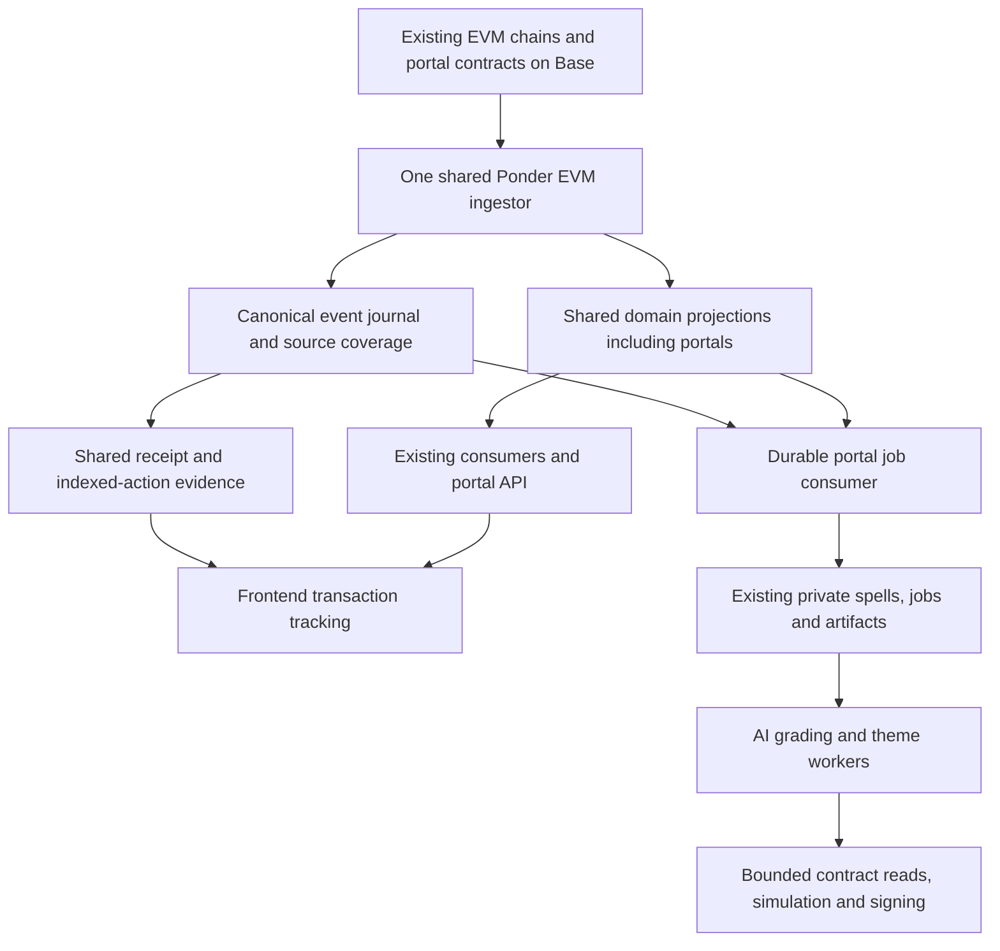

# Portal migration to the shared indexer

Prepared 13 November 2026. Planning only; this document does not activate a migration.

Move portal event ingestion, public projections and transaction evidence into the existing shared EVM indexer. Make the grading and theme workers consumers of that source. Retire the standalone portal ledger and the grading worker's independent event scanner after verification.

The deployed contracts, minted NFTs, balances, grading history, competition rules and airdrop allocations remain unchanged. No contract upgrade, repeat airdrop or user transaction is required for this migration. Private spell intake, AI processing, saved artifacts and signing remain separate application responsibilities.

This plan reflects inspected repository code. Phase 1 must refresh deployed versions, selectors, pending work and chain boundaries before implementation or cutover. Operator-specific addresses, service destinations, credentials and production evidence belong in private operations records.

## 1 Target architecture

| Component | Final responsibility |
| --- | --- |
| Shared EVM ingestor | All existing EVM sources plus portal collection, registry, grading and competition events. |
| Shared journal and projections | Canonical portal events, ownership, mint progress, rounds, grading state, accounting and competitions. |
| Shared observation and receipt support | Source identity, coverage, confirmations, reorg handling and transaction evidence. Extend the existing support rather than add another log scanner. |
| Portal HTTP API | Preserve public URLs and response behavior; read chain-derived data through a shared-source reader. Continue authorized private intake and artifact access. Keeping a domain API process does not create another indexer. |
| Portal grading and theme workers | Consume confirmed indexed work; retain AI credentials, job leases, artifacts and signing. Bounded contract reads and transaction submission remain valid worker operations. |
| Standalone portal ledger | Temporary comparison/rollback source only; stopped and disabled after acceptance. |
| Solana worker | Existing responsibility and lifecycle unchanged. |

The final deployment must have exactly one steady-state EVM log-ingestion process. A temporary candidate release may run during replay and verification, with its own schema and an explicit retirement condition. No permanent portal mirror, second `eth_getLogs` loop or API fallback to the retired ledger remains.

## 2 Establish the baseline and scope

1. Inventory the deployed shared release, Ponder version, manifest, ABIs, build, physical and read schemas, source observations, confirmation policies, receipt support, RPC profile and consumer pins. Do not assume the inspected checkout is the deployed version.
2. Inventory the portal deployment and every runtime consumer of `PortalLedgerStore`, `portal_v2_*`, `portal_v3_*`, `portal_v5_*` and the private worker ingestion cursor. Include routes, health, artifact publication, mint recovery, owner balances, competitions and frontend evidence.
3. Record deployment/start blocks and implementation changes for each portal event emitter. Confirm which contracts actually emit claim and retirement events; do not subscribe to helper contracts solely because they exist.
4. Record current mint commitments and delivered tokens, pending randomness/rotation, grading requests, active jobs, saved provider results, pending signed transactions, published versions, competition entries, payouts and themes. Preserve partial batches as well as completed work.
5. Capture a common confirmed Base boundary with its block hash, plus comparable boundaries for the other shared chains. Generate machine-readable parity fixtures and hashes in private operations storage.
6. Record existing resource usage, RPC allowance, disk/WAL headroom, source lag and HTTP error rates. Refresh the live boundary again at cutover; a planning snapshot is not a cutover checkpoint.

**Exit:** a complete old-to-new source and consumer inventory, reproducible baseline and explicit list of outstanding work. No production setting changes in this phase.

## 3 Extend the shared source release

1. Add a portal source feature to the shared source types and validators. Register four distinct Base emitters: collection, registry, grading and competition, each with verified deployment bounds, ABI identity, policies and event filters.
2. Update `ponder.config.ts`, the source manifest builder, shared deployment assertions, consumer settings, observation support and RPC authorization/profile generation. The current shared assertion requires exactly 13 sources. Replace that historical assumption with validation of the retained inventory plus the explicitly configured portal sources; do not simply remove validation or allow arbitrary additions. If the production baseline is still 13, the target becomes 17 enabled sources.
3. Require a machine-readable manifest diff proving that retained source addresses, event sets, bounds, policies and required receipt history remain unchanged unless separately explained and tested. Preserve the existing global RPC budget and counters.
4. Register the competition from its own deployment block, including initialization before the grading contract binds it. Preserve binding history. A future competition replacement requires registering its history explicitly; never silently change a source based on a latest-state address read.
5. Audit the full deployed ABI against `portalEventAbis`. Existing portal decoding recognizes 32 event names across four domains; use that as the baseline, then classify additional configuration, upgrade and control events needed for correct state or invalidation. Retain all historical ABI versions needed for replay.
6. Extend existing receipt support for portal actions where required. Current shared receipt scheduling has event-specific conditions; selecting a receipt policy alone must not leave non-Transfer portal actions without evidence. Receipts with events from several portal contracts must be covered completely.

**Exit:** an immutable shared release specification with validated source identities and no accidental changes to other products.

## 4 Implement portal projections inside shared ingestion

Use Ponder-managed tables and transactions so the canonical journal and derived state participate in its rollback lifecycle. Port the current validation rules into reusable domain reducers; do not invoke the legacy raw PostgreSQL writer from Ponder handlers.

| Domain | Required indexed state and checks |
| --- | --- |
| Collection | Token ownership, kind, mint/retirement state, live supply, configuration references and claim-controller binding. Transfers, burns and mint deliveries must reconcile. |
| Minting and randomness | Committed quantity, recipients/serial allocation where available, randomness request/result and delivered count. Preserve partially completed batches and stable request identities. |
| Registry | Rotation and selection requests, active portal and round boundaries, unavailable rounds and randomness controls. A round expires at its recorded end time even if no new activation event arrives. |
| Grading | Request, submitter, card, portal, accepted input version and commitment; completed version, four scores and artwork/report hashes; payment/rubric/artwork references and admission state. |
| Portal accounting | Fee accruals, earned/claimed/current balances, retirement and claim beneficiary. Use integer USDC units and reproduce conservation checks. |
| Competition | Entry assignment by submission order, funding, individual results, readiness, winners, tie order, settlement, paid and deferred prizes, notification recovery and themes. Never assign batches by completion order. |
| Artifact publication | Canonical onchain references to versions and content hashes. Private files/provider state remain outside the public index. |

Implementation requirements:

- Preserve Base block, transaction and log ordering across all four contracts. An event is identified by chain, emitting contract, transaction and log index, with canonical block provenance. Request IDs are namespaced by deployment/contract, not assumed globally unique.
- Keep events and the projections they affect atomic. Do not report a transaction complete while only some of its logs or domains have been applied. Coverage must advance through empty blocks using shared source observations.
- Make replay and duplicate delivery idempotent. Preserve invariants such as mint delivery not exceeding commitment, one result per competition entry, correct tie ordering, valid payout amounts and balanced portal claims.
- Derive competition rules from verified deployment/implementation data at the relevant boundary. Preserve the production batch size and contribution while supporting existing test fixtures. Do not apply today's rules retroactively to another implementation.
- Classify fields absent from event payloads, including full kind configuration and generated gates. Use bounded, canonical block-pinned reads or existing verified immutable records where necessary. Do not manufacture historical values from latest mutable state; same-block multiple updates need explicit treatment. A missing historical payload may remain unavailable while its hash/history is preserved.
- Add source-bound read views and grants. The portal API and worker get read access to public indexed state, with private operational writes confined to their existing store.
- Make portal ownership available through the shared ownership/catalog interfaces needed by portal and collector views, without inventing new leaderboard scoring or altering unrelated collection semantics.

**Exit:** deterministic replay produces complete portal state and a rollback removes orphaned events and projections together.

## 5 Switch API reads and transaction evidence

Introduce a typed portal reader backed by the registered shared release. Replace direct legacy-table queries in runtime, routes, readiness, mint/owner handlers, competition reads, health and publication checks. Keep the existing public HTTP paths; HTTP-server consolidation is not required for this migration.

The reader must bind each response to a validated release, manifest, read-view identity and relevant source coverage. Multi-source portal responses use a common canonical boundary; an unrelated source's high watermark cannot prove portal readiness. A healthy indexer process alone is insufficient.

Extend the shared indexed-action evidence machinery with a portal adapter. Successful completion requires all of:

1. The exact expected chain, sender, transaction hash, successful receipt, canonical block hash and required confirmations.
2. The selected release's matching contract/ABI identities and the receipt's complete expected portal event set, including log indices and decoded argument digests.
3. Relevant source coverage through the transaction block and application of every required projection.
4. For actions that promise published artwork, matching completed onchain versions and available verified artifacts; chain completion alone is not artifact readiness.
5. Revalidation against a release switch or reorg during the read.

Version the selection/evidence contract deliberately. Existing portal clients expect a legacy source hash and UUID generation. Add the shared identity to a version 2 response and deploy frontend support for both versions before cutover. Keep a version 1 compatibility adapter for existing tabs: its opaque compatibility generation binds the immutable shared release/read identity, while the version 2 proof also carries the validated observation revision. Its proof must be produced from the selected shared data, with canonical receipt/block checks detecting branch changes. Never relabel old evidence as belonging to the new source. Test old open tabs and persisted transactions before cutover. Retire the adapter only after compatibility-window verification; a client that is then too old must receive a recoverable reload instruction while retaining its saved transaction, never false completion or a request to send again.

Frontend behavior must remain receipt → confirmations → indexed events and projections → completion. Saved hashes, replacements, rejected wallet prompts, pending batches and reload recovery survive the source switch. Reselect and revalidate a saved transaction against the new source; do not clear it or invite resubmission because an index identity changed.

Keep read-only `action-evidence` checks out of the mutation quota. Deduplicate concurrent checks, use bounded backoff/jitter and honor retry signals. Clear completed-action polling. Return useful temporary-unavailability states and safe internal error codes distinguishing RPC, database, source lag, identity mismatch and artifact delay. Preserve legitimate submission rate limits.

**Exit:** existing URLs and frontend flows work against shared data, including old saved transactions, without weakened confirmation checks or a polling storm.

## 6 Move job discovery to indexed events

`PortalWorker.ingest()` currently performs its own `getContractEvents` scan of `GradingRequested`. Replace it with a durable shared-source consumer. Move theme discovery and competition-recovery scheduling to the indexed competition state as well; retain targeted contract checks before expensive work or signing.

1. Read confirmed canonical events using a durable position bound to source identity and block/hash provenance.
2. In one private-database transaction, enqueue/reconcile the corresponding jobs and advance the consumer position. The shared and private databases do not form one transaction: use at-least-once delivery with stable job keys and revalidation to close that gap.
3. Preserve private spells/salts, signatures, author links, embeddings, candidate comparisons, saved image/grading/theme outputs, artifact hashes, job leases, retry state and signed transaction bytes/hashes. A replay or release change must not repeat AI generation or send a new completion transaction for existing work.
4. Reconcile already completed onchain requests with the existing publication recovery path. Do not treat every historical request as new work.
5. Pause job acquisition during the short consumer handover, drain/reconcile in-flight work and establish one lease-owning worker. Resume at a verified boundary with an overlap that is safe under deduplication.
6. On reorg or source invalidation, revalidate affected jobs and stop invalid publication/signing. Keep saved expensive outputs for reconciliation; do not delete private state as part of public-index rewind. Validate the canonical binding again before provider work, signing and publication.
7. Audit remaining `getLogs`/`getContractEvents` uses. Remove steady-state portal scanning; retain only explicitly bounded diagnostic or historical-import utilities where still needed. These utilities must not be launched as fallback indexers by normal startup.

**Exit:** every canonical grading request is discovered exactly once in effect, restarts cannot skip work, and no worker performs its own continuous event scan.

## 7 Replay and compare a candidate release

1. Build from a clean, current integration base, including portal fixes already merged elsewhere. Keep unrelated workspace changes out of the migration PR.
2. Use the pinned Ponder version's supported schema/build and sync-cache behavior. Prove cache reuse in an isolated rehearsal before relying on it. A changed shared schema can require replay of retained sources as well as portals; measure that cost instead of promising a portal-only replay.
3. Run at most one temporary replacement candidate, with its own writable schema and resources. It has no AI credentials, signing capability or active job consumer. Do not copy unverified legacy rows/checkpoints into it as canonical history.
4. Replay from each source's verified beginning, including initialization. Apply the existing RPC policy and measure catch-up speed, disk/WAL growth, memory and provider usage. Stop or throttle the candidate if it degrades live ingestion.
5. Compare both datasets at the same confirmed block/hash. If the legacy projection only represents its current head, materialize a comparison snapshot or replay its journal to the selected boundary; do not compare different heads and call differences harmless.
6. Compare ordered event digests and meaningful state, not just row counts: owners and retirements, mint progress, round state, requests and versions, scores/content hashes, every fee balance, competition assignments/leaders/payouts and theme references. Check aggregate liabilities/reserves and representative contract getters at that same boundary.
7. Compare retained global consumers on their respective chains: ownership, metadata, boosters, Islands, marketplace, Arena and existing publisher/cache outputs. Preserve the Solana worker and verify its independent continuity.
8. Shadow portal API responses and action evidence using normalized source-independent values. Explain every difference; financial, ownership and canonical-event differences block promotion.
9. Require at least 30 minutes of healthy advancing observations after catching up, with required lag/freshness limits met and zero unexplained parity errors. Exercise representative flows locally even if production has no new events during this period.

**Exit:** machine-readable parity and readiness evidence supports both portal migration and continued operation of existing products.

## 8 Test the complete migration

| Layer | Required cases |
| --- | --- |
| Source and release validation | Missing/duplicate emitter, wrong ABI/address/start block, retained source changed, unregistered competition replacement, invalid read identity and receipt coverage. |
| Event/projection integration | Mint in several deliveries; transfer; retire/claim; rotation and slot expiry; grading/version changes; deferred notifications/prizes; competition ties and sequential themes. |
| Real Ponder/PostgreSQL | Cross-contract ordering, duplicate replay, empty blocks, reorg rollback, restart mid-range, failed projection, stale observations and release replacement. |
| Worker boundary | Crash before/after enqueue and cursor commit, duplicate consumption, lease transfer, pending signed transaction, completed-but-unpublished request and reorg during work. Assert no repeated provider call or duplicate signing. |
| Browser/API | Mint, finish mint, rotate, submit grading, settle and claim; receipt ahead of index; projections lagging; artifacts delayed; replacement/rejection; page reload and source switch during a pending transaction. |
| Compatibility and resilience | Old open tab, old persisted evidence, source change during response, 429/503/retry behavior and bounded request volume. |
| Existing products | Relevant shared ownership, booster, marketplace, Arena, metadata and source-selector regressions, plus startup/Solana continuity. |
| Migration rehearsal | Promote a fully caught-up candidate, perform new local actions, roll back, catch up the previous source and prove no missing work or balances. |

Use deterministic AI/VRF fixtures and real local event indexing for repeatable migration tests. Reuse existing authorized artwork/results; fresh paid generation and new mainnet transactions are not prerequisites for an indexing migration. Include a full 111-entry competition fixture to verify production allocation and payout behavior.

**Exit:** type/build checks and targeted unit, PostgreSQL, Ponder and browser suites pass; cutover and rollback have both been exercised.

## 9 Cut over production

1. Publish the reviewed release, compatible API/frontend, read grants and generated consumer settings before switching source selection. Preserve rollback artifacts and current private state; this migration does not introduce a new backup service or schedule.
2. Recheck finality, parity, current schema/build identities, consumer floors and resources. Capture the final common boundaries and hashes.
3. Briefly pause new worker leases and reconcile ongoing AI/signing work. Keep accepted requests and private uploads durable; they may wait in the queue during handover.
4. Transfer ownership of the candidate writer to the canonical shared-indexer service using the established shared-release procedure. Never run two writers against one schema. Preserve required observer/receipt support, RPC policy and the Solana child.
5. Update every consumer whose release/schema/read-view pin changes, including existing products. Changing a global default is insufficient for explicitly pinned consumers. Reject incompatible mixed-source reads until each consumer has a valid binding.
6. Switch portal reads/evidence to the shared reader, then resume the job consumer from its verified position. Confirm pending browser actions resume against the new identity.
7. Probe historical mint receipts, partial/completed batch recovery, holdings, balances, round expiry, grading/publication and competition state. Verify the public proxy path, not only the internal listener. Observe normal user activity without sending transactions merely to test the migration.
8. Stop and disable the standalone portal ledger after immediate acceptance checks. Retain its last dataset and release read-only for a recommended 48-hour rollback window. It does not need to keep scanning during that window.

**Exit:** shared ingestion serves all consumers, pending work advances, public checks pass and the standalone portal scanner is stopped.

## 10 Rollback and retirement

Rollback triggers include any incorrect owner/balance/winner, missing event or job, invalid proof of completion, persistent source lag, duplicate provider/signing work or material regression in an existing product.

To roll back, stop new job acquisition, reconcile in-flight signing, restore the previous source and reader configuration, and catch the previous ledger/source up to a verified canonical boundary before serving it. A frozen old dataset cannot immediately serve as current data. Maintain an explicit temporary-unavailable state while catching up. Keep the current private job/artifact database and its newer records; do not restore it to an older snapshot and erase work accepted after cutover. Revalidate pending browser transactions under the restored source identity. Never run competing workers or reverse shared schema changes blindly.

After the 48-hour window and healthy readiness/parity review:

- Remove the legacy production ledger entrypoint, service templates, runtime flags, unused write grants and fallback selection paths. Keep useful reducer fixtures/tests under the shared implementation.
- Remove the grading worker's log-scan cursor and scanner only after the shared consumer has reconciled all requests and the rollback code no longer depends on them.
- Remove temporary candidate processes/profiles and the comparison runner from startup. Verify there is one EVM ingestor after a controlled restart.
- Retire legacy public tables through a separate reviewed cleanup after confirming no readers remain. Preserve private spells, jobs, publications, themes, artifacts and the operational audit records.
- Update the portal runbook and implementation/completion plans so future deployments cannot recreate the independent ledger.

## 11 Implementation sequence and review boundaries

| Change | Main files or areas | Completion evidence |
| --- | --- | --- |
| Shared source support | Indexer client source types; `lib/unified/sources.ts`, `shared-deployment.ts`, `shared-consumers.ts`; Ponder configuration and schema; RPC/observer/receipt integration | Manifest diff and existing-source regression tests. |
| Portal projections and reader | New shared portal handlers/reducers and server reader; existing ledger/application logic used as reference | Canonical replay, accounting parity and real rollback tests. |
| API and evidence | Portal runtime/routes/readiness/publication/health; shared action evidence; `portalIndex.ts`; frontend transaction tracker | Compatible HTTP behavior and pending-transaction browser tests. |
| Worker integration | Grading/theme discovery, private store position/leases and recovery | Crash/restart/replay tests proving no duplicate work. |
| Release tooling and rehearsal | Shared deployment/parity utilities, fixtures, CI and generic service configuration | Candidate comparison plus cutover/rollback rehearsal. |
| Operational cutover and cleanup | Private deployment records; generic runbook and removal of legacy startup paths | Live acceptance and one-ingestor verification. |

Use reviewable commits in dependency order and keep transitional paths explicitly selected. The PR must include the migration and rollback procedure, expected source diff, compatibility behavior and test evidence. Do not merge a source switch merely because code compiles: source replay and parity are separate deployment gates.

No product decisions are needed to start implementation. Remaining engineering discoveries are the live source inventory, historical ABI/configuration coverage, supported cache reuse and measured replay cost. Resolve these in the baseline/rehearsal phases and record their effect before scheduling production cutover.
