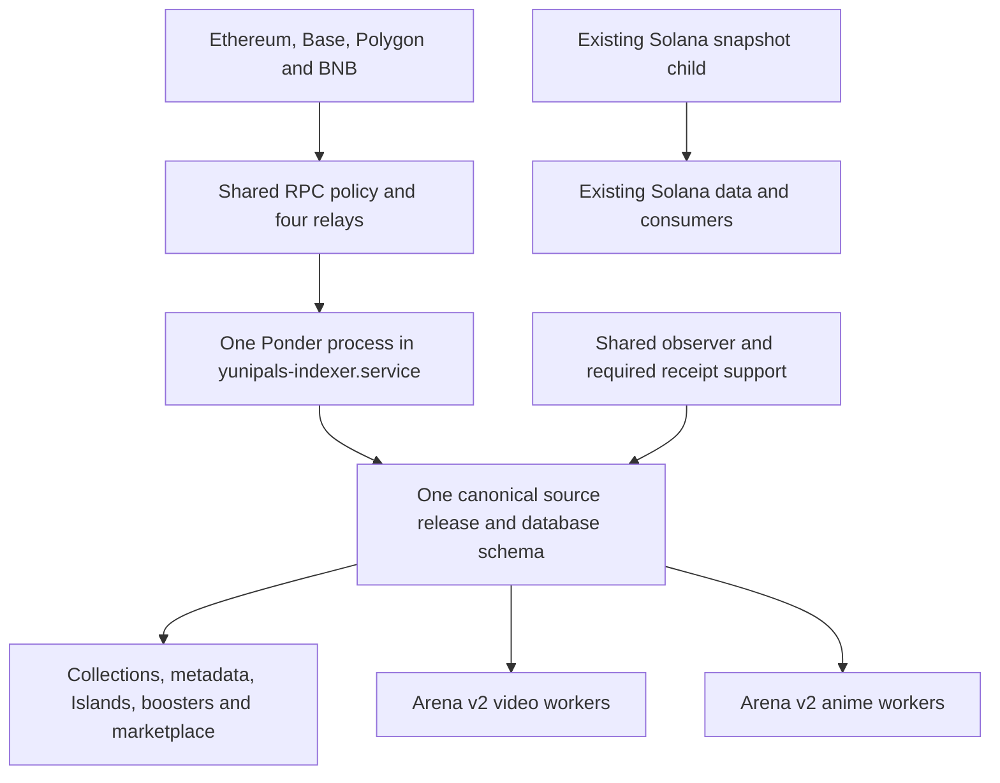

# Shared indexer transition and Arena v2 retirement plan

Prepared 2 November 2026. Implementation authorized on 2 November. The user confirmed that all old tournaments were personal tests; retire their UI and services without a historical tournament or claim interface. Claims will be handled directly onchain by the user.

Complete the original consolidation into one shared Ponder EVM indexer for Yunipals. The only active Arena product will be the new `YunipalsArenaV2`, which serves video and anime modes. Retire the previous video Arena and the standalone Anime Arena, retain the fighter registry used by v2, and remove the additional candidate indexers after migration.

The main unified indexer is not the old video Arena indexer. It also supplies collections, boosters, Islands, metadata and marketplace data. Replace its deployed source release through a controlled transition; do not delete that service or its non-Arena responsibilities.

## Decisions and target architecture

| Component | Final disposition |
| --- | --- |
| `yunipals-indexer.service` | Keep as the canonical ingestion service, running the final shared release. |
| Ponder EVM ingestion | Exactly one steady-state process covering Ethereum, Base, Polygon and BNB. |
| Solana snapshot worker | Keep the existing child and its data, scheduling and budget configuration under the managed ingestion service. Solana remains a separate worker because it is not indexed by Ponder. |
| Shared observation support | One source observer configuration for the final release, with automatic recovery. Retain necessary receipt/support work without introducing additional log scanners. |
| Arena v2 video and anime | Keep separate operational workers and mode configuration; both read the same shared source release. |
| Previous video Arena | Retire gameplay, admissions, workers and continuous indexing without retaining tournament history in the product. Contract claims remain available directly onchain. |
| Standalone Anime Arena | Retire its deployment-specific services and continuous indexing. Keep the registry, approved fighters, artwork and media required by v2. |
| Candidate Ponder services | Stop, disable and mask after ownership of the final source is transferred to the canonical service. |
| RPC routing | One final indexer profile and four chain-specific relay endpoints. Other application RPC routes may remain where needed; they are not additional indexers. |

The final manifest has **13 enabled EVM sources**, assuming the current non-Arena source inventory remains unchanged:

| Source group | Enabled sources |
| --- | ---: |
| Collection ownership on four chains | 4 |
| Base metadata | 1 |
| Ethereum Islands and Base Islands v2 | 2 |
| Booster engine, monsters and registry | 3 |
| BNB marketplace Seaport | 1 |
| Anime fighter registry | 1 |
| Arena v2, including both modes | 1 |
| **Total** | **13** |

The old video and standalone Anime contracts will not be enabled sources in the final manifest. A disabled legacy placeholder in the generated manifest is acceptable; it must not create a log filter or scanner.

Implementation inventory found that the production marketplace still uses legacy
sale readers, with depth-20 policies for Ethereum and Polygon. The final shared
manifest must explicitly add these two existing application requirements through
`UNIFIED_OWNERSHIP_DEPTHS_JSON`. Record them in the deployment specification and
reviewed RPC profile. The retained-source comparison allows only these declared
policy additions; existing policies, addresses, ABIs, ranges and receipt-history
boundaries remain exact. Migrate the marketplace operational selections with the
existing review/apply CLI, rather than retaining separate log scanners or silently
changing the confirmation policy.

## Verified starting position

The following was inspected on `yunipals-main` on 2 November. Refresh it immediately before implementation; service states and progress boundaries can change.

| Deployment | Registered release prefix | Physical schema | Enabled sources | Observed state |
| --- | --- | --- | ---: | --- |
| Main unified | `4e77f52b` | `unified_ypal_20261023_v1` | 12 | Ponder processing blocks; observer failed after boot. |
| Standalone Anime candidate | `8259ea13` | `unified_anime_20261029_v4` | 14 | Configured to start at boot; repeatedly failing startup. |
| Shared Arena candidate | `1208eee9` | `unified_arena_modes_20261029_v1` | 15 | Configured to start at boot; repeatedly failing startup. |

Both candidates contain all 12 original sources. The Anime candidate adds its registry and Arena contract. The shared candidate adds Arena v2 as a fifteenth source. Promoting the existing 15-source candidate unchanged would consolidate processes, but would leave the two retired contracts in continuous ingestion. The recommended implementation builds the final 13-source release once and migrates consumers to that release.

Material findings for the implementation:

- All four inspected Arena deployments have matching configured source IDs and database selections. Their source-selection and migration checks passed. A blind selector correction is not the repair.
- The original source observer has `Restart=no`. Its current read-only inspection passes, but observations stopped during the reboot. Restore this shared dependency during preparation if it is still down.
- The two newer RPC profiles expired on 30 October. The main profile expires on 19 November at 19:00 Berlin time. All require an explicit production lifecycle decision.
- The RPC review CLI currently accepts profile expiry up to 30 days and replay-permit expiry up to one day. It inserts approvals without overwriting existing identities; rerunning it with a later expiry does not renew the existing profile.
- Main/collector/Islands APIs, metadata, cache and leaderboard processes explicitly pin the old release and ownership view. The inspected `active_release` table is empty. Changing one global selector would not move those consumers.
- The observer entrypoint and existing reader-service renderer contain hard-coded old release/schema/profile identities. Environment-file edits alone are insufficient.
- Arena v2 already has a completed anime film, provider records and confirmed transactions. It is not an empty deployment that can be recreated.
- Saved v2 operational floors were Base block **53,288,869 for anime** and **53,278,530 for video**. These are planning observations, not future cutover boundaries; recapture the latest floors and hashes before switching.
- Indexed old-video state contains one open and one settled tournament, with **2,000,000 raw USDC units, or 2 USDC, credited across two wallets**. Confirm current contract state before retirement. Indexed v2 anime state also has existing credits and open/settled tournaments.
- Marketplace API, several marketplace workers and native staking support were unhealthy. Identify their actual errors and dependencies rather than assuming the Arena transition fixes them automatically.
- The source database occupies approximately 116 GB. Each of the three source schemas occupies about 4.5 GB, the shared Ponder sync cache about 8.2 GB, and the root disk has approximately 62 GB available. Budget candidate data, derived views/caches, WAL and backups before replay.

## Phase 1 Establish the baseline and retirement boundaries

1. Capture the current service definitions, drop-ins, enabled units and timers, running process identities, effective public selectors, physical schemas, read views, database roles, source manifests, build hashes and proxy/profile bindings. Capture secret-file hashes or presence only; keep secret contents on the server.
2. Build a consumer inventory from both service configuration and deployed code. Include readers without visible release environment variables: their selection may be embedded in an artifact, SQL view or launcher.
3. Restore the main shared observer using its verified current release/profile if it remains failed. Verify actual fresh observations on all four chains. This stabilizes the existing project while the replacement is prepared; it does not revive the old Arena product.
4. Disable new admissions and lobby creation for retired Arena deployments. Stop their operational workers after confirming no external provider submission or signed broadcast is in flight. Old tournaments were personal tests; their resolution and claims are not prerequisites for retirement.
5. Retain old contract addresses and deployment metadata for direct CLI/Basescan access. Do not submit claims, refunds, settlements or owner transactions on the user's behalf as part of retirement.
6. Remove old tournament navigation, API routing and claim UI. The user will make any old claims directly onchain; do not build or keep a legacy claim interface. Backups can retain old records without exposing them in the product.
7. Take verified backups of source/control data, Arena operational data, private jobs and media, deployed artifacts and service configuration. Rehearse the required restore into an isolated database. Keep the canonical source, shared sync cache and operational transaction records intact.
8. Diagnose the marketplace and staking failures separately. Fix source/permission/schema/startup dependencies that belong to this transition. Record any unrelated external-service failure with a clear owner and status; do not count it as a migration success or silently suppress its monitor.

**Deliverables:** a current dependency map, backup/restore evidence, legacy retirement checklist, and a public baseline containing canonical block/hash checkpoints and hashes/counts of operational records.

**Exit condition:** no new work can enter retired gameplay, old services have a recorded retirement boundary, and the continuing project has a usable baseline and rollback artifacts.

## Phase 2 Assemble the final source release

1. Use a clean, isolated implementation branch and an immutable build directory. The current workspace has unrelated changes; do not deploy it wholesale. Reconcile the deployed main and v2 artifacts with the repository before choosing the source revision.
2. Preserve all 11 non-Arena source definitions, including addresses, deployment blocks, ABIs, confirmation policies, receipt requirements and booster configuration. Compare complete definitions, not just source names or counts.
3. Keep the existing Anime registry at `0xdbcab53a8e32d43997de252fd49c43ab8df290bf` with its verified deployment block. Keep Arena v2 at `0xf34fb0a9ecf31bf7516098105036aba7ed4adda9`, deployed at Base block **53,261,777**.
4. Configure `UNIFIED_SHARED_ARENA` and its start block, plus `UNIFIED_ANIME_REGISTRY` and its start block. Set `UNIFIED_ARENA_DEPLOYMENTS=[]`, unset the standalone `UNIFIED_ANIME_ARENA`, and remove inherited legacy `ARENA_CONTRACT`/`ARENA_DEPLOYMENT_BLOCK` aliases from the ingestion environment. Those names remain valid in deployment-specific application workers.
5. Compile and assert exactly 13 enabled sources. Verify that the v2 contract uses the v2 ABI and produces both mode-specific records, while neither retired contract has an enabled filter.
6. Use a new physical schema and actual Ponder build identity for this changed source set. Do not rewrite the identity or contents of an already registered release. Register the actual compiled build through the existing registration mechanism after startup has established its schema.
7. Produce a single versioned deployment specification containing source/build/manifest hashes, schema, read-view identity, final RPC profile/endpoints and intended service configuration. Generate public consumer selectors from it while preserving separate private credentials and roles.

**Deliverables:** the immutable 13-source artifact, manifest diff, deployment specification and reproducible build evidence.

**Exit condition:** all retained source definitions match the baseline, v2 and registry definitions match confirmed deployments, and the build contains no unrelated changes.

## Phase 3 Give RPC authorization a production lifecycle

The recommended policy is an explicit **service authorization valid until revoked or replaced when its configuration changes**. Temporary candidate approvals and paid replay permits keep their deadlines. This avoids a monthly outage mechanism for ordinary production indexing.

1. Add a typed approval lifecycle to the RPC policy storage and review flow. Existing approvals remain temporary by default; nothing is silently converted into a permanent approval. Keep the database change compatible with the still-running old proxies and consumers, and test mixed old/new runtime versions before applying it.
2. Bind the selected lifecycle to the reviewed authorization, exact source manifest, profile, coordinator and request limits. Runtime access must still reject disabled profiles, changed identities, incorrect source scopes and invalid budgets.
3. Allow the final service profile to operate without a calendar expiry. Keep it explicitly revocable. Keep candidate approvals time-limited and continue enforcing the existing deadline and spending checks for every paid replay permit.
4. Preserve the current global spending caps, workload allocations, usage counters, free-only configuration and absence of new paid replay authority. Creating a new profile must not create a new account budget or reset usage.
5. Choose the final four localhost relay URLs before the build and keep them through staging and handover. Endpoint addresses are part of profile identity. Transfer service ownership of those listeners without silently changing the reviewed URLs.
6. Create only the final profile and the temporary authorization actually needed for preparation. Do not renew the obsolete standalone Anime profile. Disable obsolete source profiles after all their consumers have moved.
7. Report a clear bounded error such as `rpc_profile_expired`, `rpc_profile_disabled` or `source_observation_stale` through private operational health. Keep provider URLs, keys and raw private data out of logs.
8. Monitor remaining temporary approvals and replay permits before expiry, with alerts at seven days, one day and one hour where their lifetime allows. Routine checks should be quiet unless intervention is needed.

Implementation touches `src/db/migrations.ts`, `src/unifiedRpcPolicy.ts`, the RPC policy review command, proxy readiness and their tests in the market API. Add a migration rather than changing checksums of applied migrations.

**Exit condition:** the production profile remains valid across date changes, revocation still works, temporary/replay expiry still works, and the migration leaves all financial limits and counters unchanged.

## Phase 4 Build and qualify the replacement dataset

1. Run the existing main ingestor and at most one replacement candidate during preparation. Stop obsolete candidate startup loops after their data/configuration is captured and their dependent application work is gated. The main source continues serving existing products while replay runs.
2. Reuse Ponder's supported cache/replay mechanisms only after confirming their compatibility. Do not copy canonical tables or checkpoints into a different build and label them valid. Never let two writers use the same physical schema or mutable runtime directory.
3. Measure disk, memory, database connections, WAL growth and RPC throughput during a bounded initial replay. Reserve space for the new data, derived generations, restore/rollback overlap and the existing publication free-space requirement. Add capacity if needed rather than deleting the rollback source.
4. Run source observations against the candidate using its actual registered release. Preserve receipt-enrichment semantics required by ownership and marketplace consumers. The current generic control worker includes receipt work as well as observations; do not replace the observer with it without reviewing grants, concurrency and RPC cost.
5. Compare retained non-Arena state at a common canonical boundary for each chain. Verify ownership, metadata, booster requests/monsters/balances, Islands ownership/staking and BNB marketplace events. Compare expected records and meaningful hashes, not only row counts.
6. Verify all four approved fighter records and their exact manifests/statuses. Verify both v2 modes, tournament IDs/incarnations, entries, credits, published film hashes and canonical transaction evidence against existing records and fresh chain reads.
7. Require the candidate to meet current confirmation/finality policies and source-specific lag requirements, with observations newer than the existing three-minute readiness limit. Require it to exceed every current consumer and Arena operational floor.
8. Observe stable advancement and successful consumer probes for at least 30 minutes before scheduling the cutover. Measure catch-up rate before promising a migration date; compilation success is not dataset readiness.

**Exit condition:** all retained data agrees at comparable boundaries, the candidate is current on every required chain, v2 history is preserved, and resource/RPC usage fits the existing limits.

## Phase 5 Prepare every consumer and the service supervisor

The old global `active_release` table is empty and many consumers use explicit pins. Retain explicit, validated release selection and generate the required per-service settings from the new deployment specification. Do not introduce a global fallback as a substitute for migrating each consumer.

| Consumer group | Required migration |
| --- | --- |
| Main and collector APIs | New release and ownership read views; preserve collection queries, pagination and current monster-version behavior. |
| Metadata and read cache | New source/view identity, continued metadata history, and a complete replacement cache generation before publication. |
| Islands APIs, metadata and staking support | New release/views plus fresh canonical ownership and staking acceptance. |
| Booster API and artwork queue | Inspect embedded selectors and configuration; preserve requests, recent openings, daily claims, token versions and queued artwork identities. |
| Leaderboard and collection publishers | New source selectors and rebuilt derived generations; retain the last complete published generation until its replacement is accepted. |
| Marketplace API and workers | Inspect source/view dependencies and repair the diagnosed startup incompatibility; preserve offchain orders, stream positions and existing budget accounting. |
| Arena v2 video and anime | Same final source ID in both mode configurations, separate operational roles and modes, valid source-selection epochs and unchanged private work. |
| Solana and Exomon consumers | Preserve existing source data and snapshot worker configuration; verify restart and freshness independently. |

Additional implementation tasks:

- Replace hard-coded release constants in the observer and reader-service rendering path with a validated deployment specification. Keep exact identity verification. Do not reuse historical transition receipts, fixed PIDs or old operation directories as evidence for this migration.
- Create immutable ownership/read views and grant the existing restricted roles access before starting the replacement readers. Preserve schema separation between public source data and private Arena operations.
- Preserve private submissions, ciphertext/AAD, frozen inputs, provider request IDs, cost reservations, media artifacts, signed transaction bytes and signer nonces. A failed or completed provider task is not automatically a new generation request.
- Stage the managed service with the new source paths/schema/build, preserving the Solana child. Only one service may own the final Ponder writer at any moment.
- Order startup after the actual PostgreSQL clusters and relay services, then probe readiness. `After=` and a successful process launch alone do not establish usable databases or RPC policy.
- Add bounded retry and `Restart=on-failure` to the observer. Review how exit status 75 is classified in the main service: transient provider failures should recover, while permanent configuration mismatches must remain visible and fail closed.
- Ensure complete process-group shutdown, sufficient connection limits, graceful lease draining and repeatable startup after a host reboot. Credential files must be delivered through the retained service mechanism.

**Exit condition:** every consumer has an explicit old-to-new mapping, required grants and tested startup configuration; shadow reads pass before any production selector changes.

## Phase 6 Perform the controlled production cutover

Perform these steps in one recorded maintenance operation after the preceding gates pass:

1. Capture fresh per-chain canonical boundaries, current consumer cursors, both v2 source epochs, operational floors, and the pending provider/transaction ledger. Record the exact installed predecessor configuration for rollback.
2. Gate v2 admissions and new work; drain in-flight provider submissions and signing work. Halt both v2 operational deployments through the existing controls. Pause derived-data writers that would race with generation/source changes.
3. Stop the candidate Ponder process gracefully. Transfer the same qualified artifact, schema and runtime/cache ownership to `yunipals-indexer.service`; stop the old managed source before starting its replacement. Preserve and restart the Solana child through the supervisor. Confirm no duplicate writer exists.
4. Start the final relays and shared observation support in dependency order. Verify the Ponder build/schema still match registration after handover, both children are healthy, and fresh observations advance. A new build identity at this point requires requalification rather than an improvised override.
5. Apply the prepared reader, metadata, publisher and cache selectors in controlled groups. Verify representative product responses and complete derived generations after each group. Keep failed or partial generations unpublished.
6. Switch **each Arena v2 mode** with the existing `ArenaSourceSwitch` review/apply mechanism. Use the actual latest minimum block/hash and the matching previous epoch. Preserve immutable source-switch history and nondecreasing operational floors. Do not directly overwrite `source_selection` or reset its cursor.
7. Start v2 APIs and workers against the new binding while admissions remain gated. Verify both modes' reads, existing films, transaction reconciliation, idempotency and provider-task retention. Reconcile ambiguous provider results before any resubmission.
8. Route normal video and anime navigation to Arena v2 and its `/api/arena-v2/video` and `/api/arena-v2/anime` APIs. Remove active previous-Arena entry points and any fallback that silently selects v1. Redirect obsolete general entry URLs to Arena v2 and remove obsolete tournament detail routes; do not expose old claims or tournament history.
9. Unhalt processing and restore the pre-agreed v2 availability only after all readiness gates pass. Database migration does not unpause contracts or authorize new public paid entry; existing owner-wallet controls remain in force.
10. Verify every running consumer's effective release/schema/profile after restart, not merely the contents of newly written files.

**Exit condition:** one main Ponder process serves all retained products and both v2 modes; the source and application checks pass with new work enabled only at the agreed level.

## Phase 7 Retire the old services and prevent their return

After the old-worker drain checks and cutover acceptance:

| Service or configuration family | Retirement action |
| --- | --- |
| `yunipals-anime-native-source.service` and its observer | Stop, disable and mask. Preserve an archived source snapshot. |
| `yunipals-arena-modes-source.service` and its candidate observer | Transfer required functionality to the canonical managed service/support, then stop, disable and mask the candidate units. |
| `yunipals-arena-native-*` for the previous video Arena | Retire deployment-specific operational workers after draining; direct contract claims remain available onchain. These are not the main unified ingestion service. |
| `yunipals-anime-arena-*` for standalone Anime | Retire deployment-specific workers and timers. Retain shared registry/artwork dependencies. |
| Already masked legacy Arena/indexer units | Verify that they remain disabled and cannot be reactivated by timers, dependencies or deployment scripts. |
| Extra source RPC relay sets | Retire only after checking their consumers. Keep the final four indexer endpoints and separately required application routes. |
| Old temporary profiles, permits, selectors and alerts | Revoke unused authority; remove active references and obsolete monitor expectations. Preserve audit records. |

Add conflict/validation rules so a later deployment cannot enable a second production Ponder service accidentally. Check both enabled units and the actual process tree after restart.

Archive the old datasets, service definitions, films and recovery artifacts. Keep rollback material for at least 30 days and through the verification window, without making old claims a retention or retirement prerequisite. Storage cleanup is a separate, dependency-checked action after backup validation; the cutover does not require deleting old schemas immediately.

Update the indexer README, Arena v2 operations guide, service inventory and monitoring documentation to describe one active source, two v2 modes, and explicitly retired deployments. Remove instructions that routinely recreate independent Arena source candidates as permanent services.

## Phase 8 Verify recovery and observe normal operation

Required verification before declaring the transition complete:

- Manifest tests prove all 11 non-Arena definitions are preserved and the only active Arena source is v2; the registry remains enabled.
- PostgreSQL integration tests cover the new RPC approval lifecycle, denied/expired/revoked access, unchanged counters and paid replay limits.
- Source-reader and Arena integration tests cover both modes, branch changes/reorgs, source selection, nondecreasing floors and unchanged private job identities.
- Consumer tests cover cache/generation publication, collection/booster/version responses, Islands/staking and marketplace reads. Existing local regressions must remain distinct from new migration failures.
- A restart with delayed database or relay readiness recovers automatically. A permanent mismatch remains visibly unhealthy without starting paid/provider work.
- A controlled supervisor restart preserves Ponder checkpoints, Solana lock/schedule behavior, source observations and application readiness. A planned host reboot then proves that retired units stay down and the complete service order recovers.
- Browser/API checks exercise both v2 modes, fighter eligibility, existing tournament history, film playback, credits/claims and current mode configuration. Use the completed production artifacts for live verification and local fixtures for destructive scenarios. A new paid battle or signed owner action is a separately identified execution step when needed, not an automatic smoke test.
- Observe at least 90 minutes of healthy operation after cutover and a full 24-hour period covering scheduled jobs and daily budget rollover before closing the transition.

Monitor source lag per chain, observation age, release agreement across consumers, RPC denials/profile state, process restarts, duplicate Ponder processes, Solana snapshot freshness, database connections, disk/WAL growth and provider/transaction queues. Health must distinguish a running process from current usable data.

## Rollback procedure

Define rollback before applying the cutover. Keep immutable old artifacts/configuration and source datasets, plus a journal of every changed service, selector and Arena epoch.

1. On failed readiness or semantic parity, gate new v2 admissions/provider submissions/signing and drain work. Keep existing operational records and immutable transaction/provider identities.
2. Restore the previous consumer configuration and source service ownership in the documented order. Never run two writers against the same schema or move a consumer to a dataset behind its accepted boundary.
3. The old 12-source main release cannot serve Arena v2. If rolling v2 back to the previous 15-source dataset, first recover and verify that dataset through the current accepted floors, then use the ordinary source-switch mechanism to create valid new epochs. Restore its required RPC authorization deliberately.
4. If the former v2 source cannot become current, keep v2 closed and restore unaffected core products while repairing forward. Do not force a stale source through readiness or reduce its floor.
5. Never restore an old Arena operational snapshot over newly accepted submissions, provider results or transactions. Database backups support disaster recovery; they are not a shortcut for source-selection rollback.

Temporary overlap during recovery is recorded and removed before the transition can be marked complete. The recovery path does not reopen retired Arena gameplay.

## Implementation work packages

| Package | Main files and components | Acceptance evidence |
| --- | --- | --- |
| Source release and inventory | `apps/yunipals-indexer/lib/unified/sources.ts`, `ponder.config.ts`, source fixtures, new deployment specification under `ops/unified-indexer/` | Exact 13-source manifest, retained-definition parity, immutable build and consumer inventory. |
| RPC lifecycle and diagnostics | `apps/yunipals-market-api/src/db/migrations.ts`, `src/unifiedRpcPolicy.ts`, `scripts/review-unified-rpc-policy.ts`, `src/rpcBudgetProxy.ts` | Real database tests for permanent service authorization, temporary expiry, revocation and unchanged budgets. |
| Observer and supervision | `apps/yunipals-indexer/scripts/unified-observer.ts`, `ops/unified-indexer/run-indexer.sh`, managed/support unit templates | Validated configurable identities, readiness ordering, automatic recovery and one-writer enforcement. |
| Consumer transition | Reader-service rendering, ownership-view creation, publisher/cache selectors, feature-specific APIs/workers | Per-consumer shadow reads, current grants, preserved generations and product checks. |
| Arena cutover and retirement | `src/arena/live/sourceSwitch.ts`, `sourceSwitchCli.ts`, mode units, frontend `arenaDeployment.tsx`, route/environment configuration | Both v2 modes share the new source; private work and claims preserved; v1 tournament routes and services retired. |
| Operations and completion | Indexer/Arena runbooks, health checks, backup/restore and transition controller | Repeatable review/apply/status/rollback operation, successful restart/reboot, 24-hour observation and retired-unit audit. |

Use a new transition record tied to the current deployment. Reuse verified libraries and existing migration/source-switch mechanisms; do not modify historical accepted artifacts or run old scripts with hard-coded source identities against the new deployment.

The execution order is baseline and retirement preparation, source/runtime implementation, RPC lifecycle deployment, candidate replay and parity, consumer preparation, controlled cutover, retirement, then observation. Code preparation for the source, RPC policy and supervisor can proceed independently; production steps must follow those dependencies. No cutover date is committed until replay throughput and the retirement checks are measured.

## Definition of done

- Exactly one steady-state Ponder process and one managed Solana snapshot child.
- Exactly 13 enabled EVM sources, preserving the 11 non-Arena sources plus the registry and Arena v2.
- Every active source-dependent reader and both v2 modes use the accepted final release and compatible views.
- Previous video and standalone Anime gameplay are retired; old tournament UI/services are removed and any old claims are handled directly onchain by the user.
- No old candidate, timer or obsolete deployment process restarts after a reboot.
- No unexpected RPC approval expiry can silently stop ordinary production service, and existing spending/paid-replay limits remain enforced.
- Existing provider work, films, credits, signed transactions, collection versions and Solana data survive unchanged except for normal verified progress.
- The required product checks and observation window pass. Any separately scoped pre-existing outage is explicitly reported rather than represented as repaired.
- Backup, recovery and ongoing service ownership are documented and verified.

## Reference implementation and evidence

- [Indexer architecture and operations](../../apps/yunipals-indexer/README.md)
- [Shared Arena rollout and current retirement obligations](../../ops/arena-modes/README.md)
- [Anime plan and intended single source transition](../arena/anime-arena-plan-v1.md)
- [Source configuration and manifest generation](../../apps/yunipals-indexer/lib/unified/sources.ts)
- [Arena source-switch implementation](../../apps/yunipals-market-api/src/arena/live/sourceSwitch.ts)
- [Current RPC approval command](../../apps/yunipals-market-api/scripts/review-unified-rpc-policy.ts)
- [Current observer identity pins](../../apps/yunipals-indexer/scripts/unified-observer.ts)
- [Current reader-service renderer](../../ops/unified-indexer/configure-reader-services.py)
- [Managed production service template](../../ops/unified-indexer/yunipals-indexer.production.service)

The production observations in this plan came from hostname-verified SSH inspection, read-only database queries, local readiness endpoints and isolated read-only probes of the deployed code. Registry and contract addresses match the confirmed deployment records and installed source selections. Fresh canonical checks remain part of the implementation gates above.
